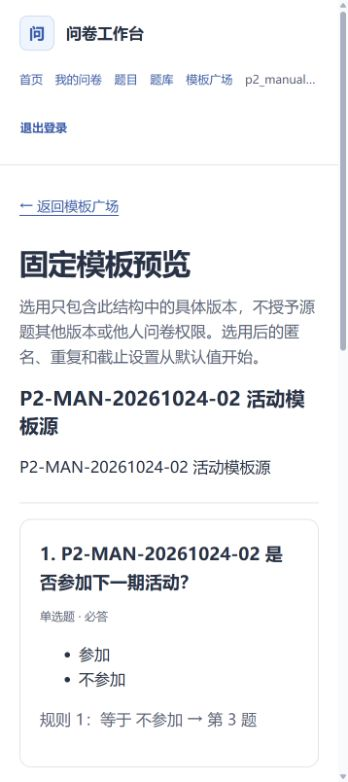
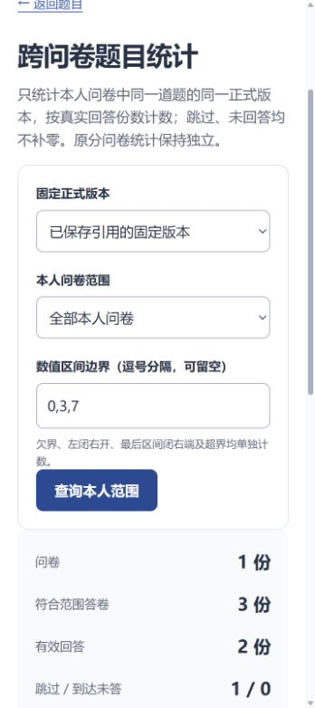
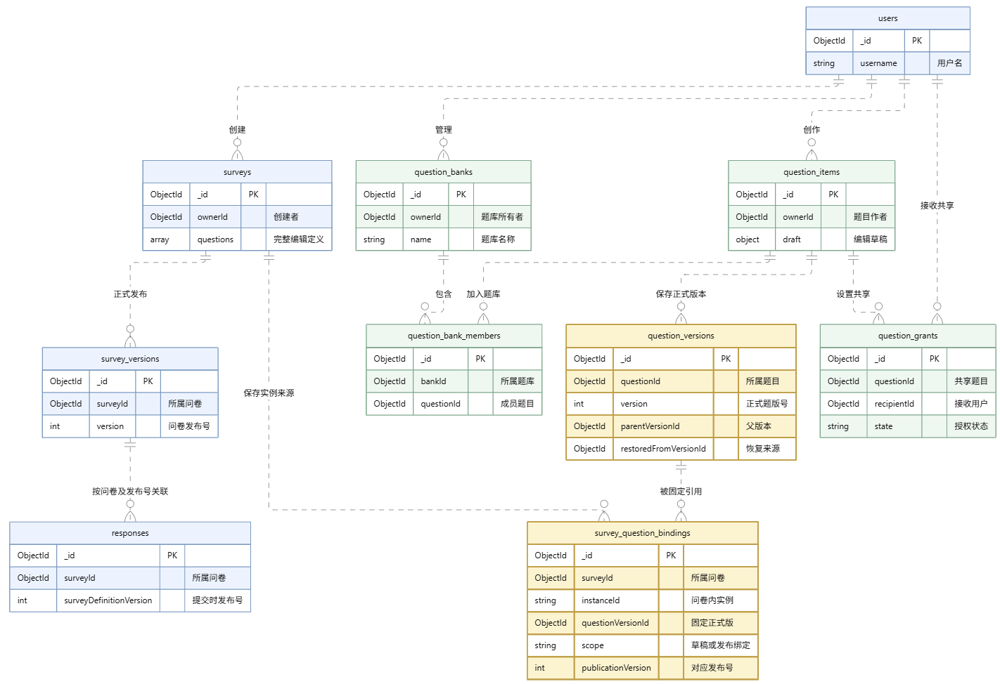

# 基于 MongoDB 的在线问卷系统 第二阶段

数据管理系统课程项目。本阶段在第一阶段代码的基础上，增加常用题目管理、正式题目版本、指定用户共享、历史恢复、使用情况查询、题库和跨问卷单题统计，并扩展了公开问卷模板功能。原有账号、问卷编辑、四种题型、条件跳转、填写提交、历史答卷和分发布版统计继续保留，业务数据仍全部存储在 MongoDB 中。

本文件沿用第一阶段 README 的组织方式，作为第二阶段运行与提交材料的总入口。完成状态依据截至 **2026-10-25** 的执行记录整理；README 更新日期为 **2026-10-26**。前端、后端及共享包的 `package.json` 版本仍为 **1.0.0**，第二阶段指课程迭代阶段。

当前主入口使用 **十三集合 `project2_app_v2`**：前端 `http://localhost:5200`，API `http://127.0.0.1:3200`，MongoDB `localhost:27019/rs0`。本机已有环境已启用数据库认证，日常运行使用下文的 `:phase2` 命令。

第二阶段代码仓库：[Ziccc1/mongodb-survey-system-phase2](https://github.com/Ziccc1/mongodb-survey-system-phase2)。第一阶段代码仓库：[Ziccc1/mongodb-survey-system](https://github.com/Ziccc1/mongodb-survey-system)。本仓库沿用第一阶段Git历史，在原系统基础上扩展。需求来源为[共同作业要求](大作业一.docx)和[第二阶段需求变更](大作业一：需求变更.docx)。第一阶段原始设计与代码摘录见[冻结基线索引](docs/baseline/phase1/INDEX.md)。

## 目录

- [页面预览](#页面预览)
- [系统说明与文档导航](#系统说明与文档导航)
- [第一阶段基础与第二阶段调整](#第一阶段基础与第二阶段调整)
- [前后端版本与环境](#前后端版本与环境)
- [配置与启动](#配置与启动)
- [使用流程](#使用流程)
- [数据库集合与Schema](#数据库集合与schema)
- [API说明](#api说明)
- [关键逻辑](#关键逻辑)
- [数据迁移与兼容](#数据迁移与兼容)
- [测试用例与预期结果](#测试用例与预期结果)
- [项目目录与提交材料](#项目目录与提交材料)
- [当前范围与限制](#当前范围与限制)

## 页面预览

以下截图来自第二阶段实际浏览器辅助验收，展示固定模板预览和跨问卷统计。截图中的账号、问卷与数值属于本地验收数据，具体输入和结果见[执行记录](docs/testing/phase2-runs/assisted-manual-20261024/README.md)。

| 固定公开模板 | 跨问卷单题统计 |
| --- | --- |
|  |  |

原有编辑、填写和分版本统计页面继续使用；[第一阶段页面预览](docs/ui-preview.md)保留其原执行时间。[界面收尾记录](docs/testing/phase2-runs/delivery-20261025/README.md)包含第二阶段多尺寸及键盘检查。

## 系统说明与文档导航

系统由 Vue 前端、Fastify API、共享 TypeScript 逻辑和 MongoDB 组成。前端负责编辑与填写交互；后端负责身份、权限、正式版本、来源绑定、统计和事务；共享包提供题型、校验、十进制处理及跳转计算。第二阶段沿用原有分层，扩展题目管理、共享与模板服务。

| 材料 | 内容及阅读方式 |
| --- | --- |
| [系统设计](docs/system-design.md) | 原有架构、第二阶段模块及职责 |
| [前后变更对照](docs/phase2/change-analysis.md)、[业务决策](docs/phase2/requirements-decisions.md) | 原设计、新问题、修改原因、八项需求及确认规则 |
| [数据库设计](docs/database-design.md) | 十三集合字段、嵌套结构、引用、索引与版本关系 |
| [可执行Schema](apps/api/src/database/phase2-schema.ts)、[存储类型](apps/api/src/database/phase2-models.ts) | 实际验证器、索引和 BSON 类型 |
| [API说明](docs/api.md)、[机器契约](docs/phase2/api-contracts.json) | 新增与保留端点、参数、响应、权限及错误码 |
| [关键逻辑](docs/key-logic.md) | 跳转、校验、发布、提交、事务与统计 |
| [题目、题库、共享及绑定实现](docs/phase2/w02-w04-implementation.md) | 正式版本、引用、主动换版与使用查询 |
| [跨问卷统计](docs/phase2/cross-survey-statistics.md)、[模板与公开授权](docs/phase2/template-square.md) | 两个新增模块的算法、页面与验证 |
| [认证部署](docs/phase2/authorization-deployment.md)、[真实数据迁移](docs/phase2/real-migration-verification.md) | 当前认证配置、实际迁移结果及运行边界 |
| [最新交付核对](docs/phase2/delivery-verification.md) | 收尾修复、认证、迁移和数据保护的最终事实 |
| [自动验收](docs/testing/phase2-automated-acceptance.md)、[人工验收](docs/testing/phase2-manual-acceptance.md) | 自动运行方法、人工问卷配方及步骤；实际结果另见证据 |
| [人工实际结果](docs/testing/phase2-manual/06-results.md)、[浏览器执行证据](docs/testing/phase2-runs/assisted-manual-20261024/README.md) | 实际问卷、输入、回执、统计与数据库核对 |
| [第二阶段AI提交日志](docs/ai/phase2-submission-log.md)、[提示词来源](docs/ai/phase2-submission-prompts.md) | 18项开发任务的工具、输入、输出、修改和验证 |
| [项目报告](PJ1_2.docx) | 由作者整合的第二阶段报告，包含设计、修改过程、测试及AI参与说明 |

带日期的过程文档保留当时状态；当前运行方式以本 README 为准，收尾结果以最新交付核对为准。第一阶段[测试用例](docs/testing/submission-test-cases.md)和[AI日志](docs/ai/submission-log.md)继续作为历史材料保留。

## 第一阶段基础与第二阶段调整

### 第一阶段已完成的内容

| 模块 | 已实现并在第二阶段保留的内容 |
| --- | --- |
| 账号与权限 | 注册、登录、退出；创建者管理自己的问卷，填写者先登录 |
| 问卷管理 | 标题、说明、匿名与重复策略、截止时间、预览、发布、暂停、重新发布和关闭 |
| 题目与跳转 | 单选、多选、文本、数字四种题型；必答、选项、数量/长度/数值限制；按回答向后跳转 |
| 填写与提交 | 分页填写、改答后清理失效分支、后端重算路径、独立保存答卷、提交重试与防重复 |
| 历史与统计 | 不可变发布快照、历史答卷、单卷及单题分发布版统计、选择频数、文本原文和数字均值 |
| 数据结构 | `users`、`surveys`、`survey_versions`、`responses` 四集合；题目嵌入问卷定义，答卷引用发布版本 |

### 第二阶段需求与完成内容

第一阶段的题目属于某份问卷，缺少跨问卷复用所需的独立身份、题目版本和授权关系。本阶段为题目增加独立管理能力，同时继续在问卷中保存实际使用的完整内容，让填写、校验和历史解释沿用原流程。

| 教师新增需求 | 第二阶段已完成的功能 | 相对第一阶段的调整 |
| --- | --- | --- |
| 1. 保存常用题目、重复选用 | 独立题目草稿、正式题版；本人题目和题库选题 | 新增题目身份；同一道题可被多个问卷引用 |
| 2. 分享题目给其他用户 | 按已注册用户名共享与撤销；接收者选用正式版本 | 增加题目级授权；保留问卷管理和答卷权限边界 |
| 3. 修改不影响已有问卷 | 问卷固定明确题版；新版提示、主动替换、暂停后重发 | 题目版本与问卷发布版本分别管理；历史快照不跟随题库变化 |
| 4. 修改历史与恢复 | 历史列表、父版本、恢复来源、派生来源 | 恢复旧内容时新增正式版本，并保留已有历史及待保存草稿 |
| 5. 不同版本同时存在 | 基于任意正式版编辑；不同问卷可用不同题版 | 增加版本来源关系；同一问卷也允许同题不同版共存 |
| 6. 查询被哪些问卷使用 | 按题版查看草稿、当前发布和历史使用，按问卷汇总 | 新增实例绑定；他人使用仅展示用户名、独立问卷编号和使用状态 |
| 7. 建立题库 | 创建、改名、加入/移出题目、删除题库及从题库选题 | 题库只整理成员，正式版本由题目统一管理；目录操作保留原题 |
| 8. 跨问卷单题统计 | 本人有统计权限的问卷中，同题同版回答汇总 | 保留原单卷统计，新增独立跨卷接口、页面和快照分页 |
| 项目扩展：模板广场 | 固定发布版模板、预览、选用、上下架和具体题版公开授权 | 公开问卷结构；选用生成独立草稿，保留来源并重新映射实例与跳转 |

模板广场建立在题目复用、版本固定和共享之上，是项目扩展功能。八项教师需求仍分别由上表对应模块完成。

数据库由 **4集合扩展为13集合**；程序新增服务、路由和页面，通过适配层将“正式题目内容＋问卷实例配置”组合为原有题目结构。题干、题型、选项和输入限制可以复用；必答、跳转及题序由每份问卷独立设置。问卷内新建的本地题目也保留，但发布前需要显式保存为正式题版。

## 前后端版本与环境

依赖版本以各级 `package.json` 和 `package-lock.json` 为准，使用 `npm.cmd ci` 安装。应用包继续使用原1.0.0版本号。

| 分类 | 组件 | 项目版本或已验证环境 | 用途 |
| --- | --- | --- | --- |
| 运行环境 | Node.js / npm | 已验证22.17.0 / 10.9.2；要求Node `>=22.12.0 <23`、npm `>=10 <11` | 后端、构建与测试 |
| 前端 | Vue / Vue Router | 3.5.44 / 4.6.4 | 页面与路由 |
| 前端构建 | Vite / vue-tsc / @vitejs/plugin-vue | 8.3.4 / 3.3.13 / 6.0.10 | 开发、构建和类型检查 |
| 图表 | ECharts | 6.1.0 | 选择题统计图表 |
| 后端 | Fastify | 5.12.7 | API服务 |
| 数据访问 | MongoDB原生Node.js驱动 | 7.7.0 | BSON、查询、聚合与事务 |
| 认证与请求控制 | jose / @fastify/cookie / @fastify/rate-limit | 6.2.12 / 11.1.3 / 10.3.0 | JWT、Cookie及限流 |
| 静态资源 | @fastify/static | 10.1.6 | 构建版同源访问 |
| 共享逻辑 | TypeScript / decimal.js / tsx | 5.9.3 / 10.6.0 / 4.23.15 | 类型、精确十进制处理与开发执行 |
| 数据库 | MongoDB | 已验证8.3.11，单节点副本集 `rs0` | 持久化与事务 |
| 数据库终端 | mongosh | 已验证2.11.1 | 只读查询与核查 |
| 浏览器测试 | @playwright/test | 1.64.1，优先使用本机Edge | 自动浏览器测试 |

启动与实例归属检查面向 **Windows PowerShell**，要求 `mongod.exe` 在 PATH 中。MongoDB需以副本集方式运行。网站账号与MongoDB应用账号分别管理。

## 配置与启动

### 已有本机环境的日常启动

在项目根目录执行，确认 `.env.phase2` 及其引用的本机私有凭据可读取：

```powershell
Set-Location -LiteralPath 'D:\大三\数据库\pj1_2'
npm.cmd run db:start
npm.cmd run db:verify:phase2
```

两个终端分别启动：

```powershell
npm.cmd run dev:api:phase2
```

```powershell
npm.cmd run dev:web:phase2
```

访问 **http://localhost:5200**。Vite将 `/api` 代理到3200端口。已在运行的服务无需再次启动；端口被占用时先确认进程归属。正常前台服务用 `Ctrl+C` 停止。

### 新电脑首次安装与初始化

以下步骤用于新的项目专用数据库；替换项目路径后，在根目录执行：

```powershell
Set-Location -LiteralPath 'D:\大三\数据库\pj1_2'
npm.cmd ci
npm.cmd run configure
npm.cmd run configure:phase2
npm.cmd run build
npm.cmd run db:start
npm.cmd run db:init:phase2
```

随后按上文分别启动API和前端。`configure`生成保留的 `.env`，供默认构建和原功能回归读取；`configure:phase2`生成主应用的 `.env.phase2`。两者分别生成独立随机密钥，均不覆盖已有配置。`build`先生成共享包、后端和前端产物，初始化脚本也依赖共享包产物。`db:init:phase2`创建缺失的集合与索引，并检查已有结构；旧格式或不一致数据库需通过专门迁移流程处理。

仓库不包含 `.env.phase2`、数据库文件和私有凭据。在全新环境中，上述命令先建立本机开发实例；**认证需要单独部署**，不会因为运行初始化命令自动完成。若在已有认证实例上运行，应使用该实例原有的凭据配置。

### 环境配置

第二阶段配置由[生成脚本](scripts/configure-phase2.mjs)创建，并由[配置检查](apps/api/src/config.ts)读取；[.env.example](.env.example)是保留的四集合基线模板。

| 配置项 | 第二阶段默认值或来源 | 含义 |
| --- | --- | --- |
| `MONGODB_URI` | `mongodb://localhost:27019/project2_app_v2?replicaSet=rs0` | 本机数据库地址、库名及副本集 |
| `MONGODB_DB` | `project2_app_v2` | 必须与URI中的库名一致 |
| `APP_ORIGIN` | `http://localhost:5200` | 写请求允许的浏览器Origin |
| `PUBLIC_APP_URL` | `http://localhost:5200` | 分享根地址，必须与APP_ORIGIN相同且无末尾斜杠或子路径 |
| `API_HOST` / `API_PORT` | `127.0.0.1` / `3200` | 后端监听配置 |
| `WEB_HOST` | `localhost` | Vite监听地址；端口从PUBLIC_APP_URL读取 |
| `JWT_SECRET` | 配置脚本随机生成，至少48字符 | 登录签名密钥 |
| `CURSOR_SECRET` | 另行随机生成，至少48字符 | 分页游标签名密钥，不能与JWT密钥相同 |
| `MONGODB_AUTH_FILE` | 已部署环境为 `.local/security/application.json` | 本机应用数据库凭据文件；认证部署时加入配置 |

配置检查限定本机 `localhost/127.0.0.1:27019`、`rs0` 和明确库名。第二阶段入口允许 `project2_app_v2` 或受控 `project2_test_*`；四集合入口使用 `project2_app_v1`。两个应用模式默认共用3200/5200，不能同时占用相同端口。

| 运行模式 | 配置 | 入口 | 用途 |
| --- | --- | --- | --- |
| 第二阶段主应用 | `.env.phase2` | `dev:api:phase2`、`dev:web:phase2`、`start:phase2` | 十三集合完整功能 |
| 四集合兼容基线 | `.env` | `dev:api`、`dev:web`、`start` | 保留的旧功能兼容检查，不作为本阶段使用入口 |
| 自动测试 | 测试夹具分配的 `project2_test_*` | 自动验收运行器 | 隔离合成数据、回归与受控异常检查 |

### 构建版运行与数据库认证

构建版将 `.env.phase2` 中 `APP_ORIGIN` 和 `PUBLIC_APP_URL` 均改为 `http://localhost:3200`，停止开发服务后执行：

```powershell
npm.cmd run build
npm.cmd run start:phase2
```

访问 **http://localhost:3200**，由后端同时提供前端资源和API。切回开发模式时，两项地址恢复5200并重启服务。localhost链接仅本机可访问，网络访问配置参考[部署说明](docs/deployment.md)，其中旧阶段路径和端口应替换为本页配置。

当前本机认证部署已完成，应用使用受限身份，管理员另行用于维护。新环境如需部署相同角色，应先初始化十三集合并创建一份样例问卷，再停止API，按[认证部署说明](docs/phase2/authorization-deployment.md)执行 `node scripts/secure-phase2.mjs provision`，正常停止并重新启动MongoDB，再运行 `node scripts/secure-phase2.mjs verify` 和 `npm.cmd run db:verify:phase2`。部署脚本会保存备份、生成凭据与keyFile并更新配置，`verify`包含基于已有问卷的事务回滚探针。

正常停止MongoDB的命令为：

```powershell
powershell.exe -NoProfile -ExecutionPolicy Bypass -File scripts/stop-mongo.ps1
```

`.local/security`中的应用凭据、管理员凭据和keyFile只保留在部署机器上；应用不会自动改用管理员身份。启动、停止及就绪检查均核对专用实例和目录。详细角色权限及实测结果见认证部署说明。

## 使用流程

1. 注册并登录，在“题目”中创建单选、多选、文本或数字题，编辑题干、选项和输入限制。保存草稿保留进度，点击保存正式版本后生成可选用的题版。
2. 在“题库”创建目录并加入题目；在题目页按用户名共享给已注册用户。接收者从“共享给我”选题，可使用具体正式版，也可在授权范围内派生自己的题目。
3. 创建问卷，设置基本信息、匿名/重复策略及截止时间。从本人题目、共享题目或题库选明确题版，设置每个实例的必答、顺序和跳转。本地新增题目在发布前显式保存为正式题版。
4. 浏览预览或模拟填写，修正校验和跳转问题后发布。发布成功后进入“发布与收集”，复制稳定分享链接。预览不写入正式答卷。
5. 填写者登录后按有效路径填写并提交。改答后清理不再经过的分支；若提交结果未知，以原标识、内容和发布号确认原请求。
6. 题库出现新版时，由创建者主动选择是否换版。正在收集的问卷先暂停，换版后核对受影响规则，再重新发布；问卷ID和分享链接保留。
7. 在题目历史中查看来源、恢复旧版或派生；在使用情况中查看各题版的问卷状态。恢复会新增正式版本。
8. 通过问卷统计查看某个发布版，通过“跨问卷题目统计”汇总本人问卷中同题同版的回答。
9. 在本人问卷“发布与收集”页面选择明确发布版创建固定公开模板；涉及他人题目时先取得具体题版对模板发布者的公开分发授权。其他用户在“模板广场”预览并选用，生成自己的草稿后独立配置和发布。

私人共享与公开分发分别授权。撤销私人共享后，已经保存的问卷实例仍可配置、发布、填写和统计，新引用、获取新版与一般派生被阻止。模板下架或公开权撤销后阻止新的选用，已经生成的问卷保留。

## 数据库集合与Schema

当前主应用使用 **13个集合、28个业务索引**（另有各集合的 `_id_` 索引）。可执行定义见[phase2-schema.ts](apps/api/src/database/phase2-schema.ts)，结构注册见[schema-registry.ts](apps/api/src/database/schema-registry.ts)，完整字典见[数据库设计](docs/database-design.md)。

### 保留并扩展的四个集合

下表只列核心字段。实体ID使用ObjectId，时间使用BSON Date，数值答案及数字边界使用Decimal128；完整必填项以可执行Schema为准。

| 集合 | 核心字段 | 第二阶段处理 |
| --- | --- | --- |
| `users` | `_id`、`username/usernameKey`、`passwordHash`、`createdAt/updatedAt` | 保留账号和密码哈希；用户名规范化唯一 |
| `surveys` | `_id/ownerId`、`publicId`、`title/description/status`、`questions[]`、`revision/definitionVersion`、`currentPublishedVersion`、计数与策略 | 新文档格式3，增加独立 `usageNumber` 和可空 `originTemplate`；保留编辑定义及完整题目 |
| `survey_versions` | `surveyId/version`、`definition`、`policySnapshot`、`definitionHash`、发布请求信息 | 新发布快照格式2增加 `bindingHash`；旧格式1快照保留原定义与摘要 |
| `responses` | `surveyId/surveyDefinitionVersion`、`respondentId`、`anonymous/repeatAllowed`、`requestId/payloadHash`、`answers[]` | 继续使用格式2；原答卷及其发布版关联保留 |

### 新增九个集合

| 集合 | 核心字段 | 一份文档的含义 |
| --- | --- | --- |
| `question_items` | `ownerId`、`draft`、`latestVersionId/nextVersion`、`revision/accessFence`、`origin` | 题目身份、编辑进度、正式版指针及来源 |
| `question_versions` | `questionId/version`、`content/contentHash`、`parentVersionId/restoredFromVersionId`、`operation/distributionSource` | 一个固定正式题版及版本、派生和分发来源 |
| `question_banks` | `ownerId/name/revision`、`deletedAt` | 一个题库目录，删除采用标记 |
| `question_bank_members` | `bankId/questionId/ownerId` | 题库与题目的成员关系，不复制题目 |
| `question_grants` | `questionId/recipientId/grantedBy`、`state/revision/revokedAt` | 一道题对一个接收者的私人共享状态 |
| `survey_question_bindings` | `surveyId/instanceId`、`scope/publicationVersion`、`questionId/questionVersionId/contentHash`、取得授权的记录 | 问卷草稿或发布版中某个实例的固定来源 |
| `survey_templates` | `publisherId`、`sourceSurveyId/sourcePublishedVersion`、`questions/bindings`、`contentHash/status/revision/accessFence` | 一份固定公开结构、来源证明及上下架状态 |
| `template_grants` | `questionId/questionVersionId/publisherId/grantedBy`、`state/revision/revokedAt` | 某具体题版对某模板发布者的公开分发授权 |
| `operation_receipts` | `actorId/operation/resourceKey/requestKey/requestHash`、`firstHttpStatus/resultVersion/result` | 一次新增业务操作首次成功的完整回执 |

`accessFence`是内部并发协调计数。新增使用和撤权在事务内共同更新相关记录，使冲突操作重新检查授权；它与用户编辑使用的 `revision` 分别管理。

### Schema简要定义

以下按实际存储结构展示13个集合的主要字段，使用类型简写，省略公共时间字段和部分业务字段。`ObjectId`是数据库实体ID，`Int`表示受安全整数范围约束的BSON int/long，`Date`是BSON日期；`Content`、`Question`和`Answer`中的数字边界及数字答案使用Decimal128。这里用于阅读结构，完整必填项、长度及条件约束见[可执行Schema](apps/api/src/database/phase2-schema.ts)。

```text
users {
  _id: ObjectId, schemaVersion: 1,
  username: String, usernameKey: String, passwordHash: String
}
surveys {
  _id: ObjectId, schemaVersion: 3, ownerId: ObjectId,
  publicId: String, usageNumber: String, title: String,
  status: "draft" | "published" | "paused" | "closed",
  questions: Question[], revision: Int, definitionVersion: Int,
  currentPublishedVersion: Int | null,
  originTemplate: { templateId: ObjectId, contentHash: String, acquiredAt: Date } | null
}
survey_versions {
  _id: ObjectId, schemaVersion: 2, surveyId: ObjectId, version: Int,
  definition: { title: String, description: String, questions: Question[] },
  policySnapshot: { allowAnonymous: Boolean, allowRepeat: Boolean },
  definitionHash: String, bindingHash: String
}
responses {
  _id: ObjectId, schemaVersion: 2, surveyId: ObjectId,
  surveyDefinitionVersion: Int, respondentId: ObjectId,
  anonymous: Boolean, repeatAllowed: Boolean,
  requestId: String, payloadHash: String, answers: Answer[]
}
question_items {
  _id: ObjectId, ownerId: ObjectId, revision: Int, accessFence: Int,
  draft: { content: Content, baseVersionId: ObjectId | null, revision: Int } | null,
  latestVersionId: ObjectId | null, nextVersion: Int, origin: QuestionOrigin | null
}
question_versions {
  _id: ObjectId, questionId: ObjectId, version: Int,
  content: Content, contentHash: String,
  parentVersionId: ObjectId | null, restoredFromVersionId: ObjectId | null,
  operation: "save" | "restore" | "fork" | "legacyImport",
  distributionSource: DistributionSource
}
question_banks {
  _id: ObjectId, ownerId: ObjectId, name: String, revision: Int, deletedAt: Date | null
}
question_bank_members {
  _id: ObjectId, bankId: ObjectId, questionId: ObjectId, ownerId: ObjectId
}
question_grants {
  _id: ObjectId, questionId: ObjectId, recipientId: ObjectId, grantedBy: ObjectId,
  state: "active" | "revoked", revision: Int, revokedAt: Date | null
}
survey_question_bindings {
  _id: ObjectId, surveyId: ObjectId, ownerId: ObjectId, instanceId: String,
  questionId: ObjectId, questionVersionId: ObjectId, contentHash: String,
  scope: "draft" | "publication", publicationVersion: Int,
  snapshotHash: String | null, authorization: AuthorizationProof
}
survey_templates {
  _id: ObjectId, publisherId: ObjectId,
  sourceSurveyId: ObjectId, sourcePublishedVersion: Int,
  title: String, description: String, questions: Question[], bindings: TemplateBinding[],
  contentHash: String, status: "listed" | "unlisted", revision: Int, accessFence: Int
}
template_grants {
  _id: ObjectId, questionId: ObjectId, questionVersionId: ObjectId,
  publisherId: ObjectId, grantedBy: ObjectId,
  state: "active" | "revoked", revision: Int, revokedAt: Date | null
}
operation_receipts {
  _id: ObjectId, actorId: ObjectId, operation: String,
  resourceKey: String, requestKey: String, requestHash: String,
  firstHttpStatus: Int, resultVersion: 1, result: { kind: String, data: Object }
}
```

新增九个集合的 `schemaVersion` 均为1，并具有 `createdAt`；可修改实体另有 `updatedAt`。上面展示新建问卷和新发布快照的格式，验证器同时接受旧问卷格式2、旧快照格式1。草稿绑定要求 `publicationVersion=0`、`snapshotHash=null`，发布绑定要求发布号大于等于1且带快照摘要。操作回执的 `operation`、HTTP状态和 `result` 按具体操作分别校验，来源与授权也有各自的结构分支；完整类型见[存储模型](apps/api/src/database/phase2-models.ts)。

例如，`question_bank_members`展开后的MongoDB验证器如下。它要求六个字段齐全、ID为ObjectId、时间为Date，并拒绝额外字段；成员唯一性由后面的复合索引保证。

```javascript
const validator = {
  $jsonSchema: {
    bsonType: "object",
    additionalProperties: false,
    required: ["_id", "schemaVersion", "createdAt", "bankId", "questionId", "ownerId"],
    properties: {
      _id:           { bsonType: "objectId" },
      schemaVersion: { bsonType: "int", enum: [1] },
      createdAt:     { bsonType: "date" },
      bankId:        { bsonType: "objectId" },
      questionId:    { bsonType: "objectId" },
      ownerId:       { bsonType: "objectId" }
    }
  }
};
```

初始化时使用 `validationLevel: "strict"`、`validationAction: "error"`，由统一初始化脚本创建集合和索引。

### 内容、配置与版本关系

| 结构 | 字段或定位方式 | 用途 |
| --- | --- | --- |
| 可复用Content | `type/title/options/validation` | 正式题版内容；数值边界以Decimal128存储 |
| 实例配置 | `required/jumpRules`及问卷数组位置 | 每份问卷独立配置；不因此新增题版 |
| 物化题目 | `id`＋Content＋实例配置 | 保留原扁平结构，供编辑、填写、校验和路径计算使用 |
| 答案 | `questionId/type`＋`optionId/optionIds/text/number` | 此处questionId是问卷内实例ID，number以Decimal128保存 |
| 题目正式版 | `questionId + version`或 `questionVersionId` | 确定复用内容和修改历史 |
| 问卷发布版 | `surveyId + version` | 确定整份问卷当次发布的定义和策略 |
| 答卷解释 | `responses.surveyId + surveyDefinitionVersion` | 找到对应发布快照，再按实例ID和绑定确定题版 |

问卷内部实例、选项和规则使用稳定字符串ID。独立题目和正式题版使用ObjectId，接口中表示为24位十六进制字符串。`schemaVersion`表示文档格式，`revision`用于并发编辑，题版号和问卷发布号各自分配。

### 第二阶段核心ER图



[查看原尺寸ER图](docs/figures/phase2-core-er.png)。本图与第二阶段报告使用同一张图片：蓝色表示第一阶段保留的用户、问卷、发布快照和答卷；绿色表示新增的题目、题库、成员和共享；黄色突出正式题目版本及实例来源绑定，展示题目从问卷内部内容扩展为可复用、可追溯实体的变化。

图中列出10个核心集合的主要字段与关系。`survey_templates`、`template_grants`和`operation_receipts`三个集合的字段与作用见上方“新增九个集合”，分别支持固定公开模板、具体题版分发授权和成功操作回执。完整数据库共13个集合。

快照与答卷按问卷ID和发布号复合定位，正式版与父版通过版本ID关联；模板内部绑定保存固定题版及分发证明。集合间引用的存在性、归属与权限由后端检查，跨集合写入由事务保证。

题目、选项和校验通常整体读取，使用嵌套文档；正式版本、答卷、共享及使用关系需要独立增长和查询，使用独立集合。关系数据库也可以用题目、选项、版本及关联表表达这些关系。本项目利用MongoDB嵌套结构保存四种题型与完整发布快照，再以引用支持复用查询。正式题版和问卷中的内容冗余分别服务于复用管理与历史固定，内容摘要用于检查两者是否一致。

### 关键索引与事务

| 集合 | 唯一索引字段 | 作用 |
| --- | --- | --- |
| `users` | `usernameKey` | 规范化用户名唯一 |
| `surveys` | `publicId`；`usageNumber`（字符串部分索引） | 分享标识和独立问卷编号唯一 |
| `survey_versions` | `surveyId, version` | 问卷发布号唯一 |
| `responses` | `surveyId, respondentId, requestId`；`surveyId, respondentId`（仅repeatAllowed=false） | 提交重试和问卷级防重复 |
| `question_versions` | `questionId, version` | 同题正式版本号唯一 |
| `question_bank_members` | `bankId, questionId` | 防止同题重复入同一题库 |
| `question_grants` | `questionId, recipientId` | 每题对每个接收者保存一条授权状态 |
| `survey_question_bindings` | `surveyId, scope, publicationVersion, instanceId` | 同一草稿或发布版内实例来源唯一 |
| `template_grants` | `questionVersionId, publisherId` | 具体题版与发布者的授权状态唯一 |
| `operation_receipts` | `actorId, operation, resourceKey, requestKey` | 同一业务操作标识只保存一次成功结果 |

另有作者列表、接收共享、题目使用和模板列表等查询索引，完整名称、键顺序及部分索引条件见可执行Schema。同题同版在同一草稿或新发布版内最多出现一个实例，由业务校验实现；同题不同版可以共存，同版跨多个历史发布版也可以保留。

正式保存、引用、换版、发布、提交及模板选用均在事务中完成相关写入。例如保存正式版同时写入版本、更新题目指针并保存回执；选用模板同时创建问卷、来源绑定和回执。验证器约束必填字段、BSON类型、枚举及嵌套结构；动态权限、来源真实性、跳转语义和摘要一致性由后端校验。

当前受限应用身份对 `users/question_versions/survey_versions/responses/operation_receipts` 只有读取与插入等必要权限，不能更新或删除这些集合的文档；其他集合按业务配置更新或移除权限。字段级不变性及绑定中的草稿/发布行区别由应用维护，管理员另有维护权限。详见[实际角色部署](docs/phase2/authorization-deployment.md)。

### 数据库核对

在PowerShell连接本机实例：

```powershell
mongosh 'mongodb://localhost:27019/project2_app_v2?replicaSet=rs0'
```

已部署认证的本机环境，在mongosh内读取私有应用凭据并认证后再查询：

```javascript
var p2LocalAuth = JSON.parse(require('fs').readFileSync('D:/大三/数据库/pj1_2/.local/security/application.json', 'utf8'));
db.getSiblingDB(p2LocalAuth.authSource).auth(p2LocalAuth.username, p2LocalAuth.password);
p2LocalAuth = null;
db.getCollectionNames();
db.surveys.find({}, { title: 1, usageNumber: 1, currentPublishedVersion: 1, submissionCount: 1 }).limit(5);
db.question_versions.find({}, { questionId: 1, version: 1, parentVersionId: 1, restoredFromVersionId: 1 }).limit(5);
db.survey_question_bindings.find({}, { surveyId: 1, scope: 1, publicationVersion: 1, instanceId: 1, questionVersionId: 1 }).limit(5);
```

新电脑替换凭据文件的绝对路径。完整只读检查见[MongoDB核对步骤](docs/testing/phase2-manual/07-mongodb-inspection.md)，按实际问卷、题目和版本ID查询。

## API说明

公共前缀为 **`/api/v1`**，成功响应包装为 `{ "data": ... }`；错误响应为 `{ "error": { "code", "message", "details", "traceId" } }`（结构示意）。同源Cookie认证，写请求需要正确Origin及 `X-CSRF-Guard: 1`，有正文时使用JSON。

完整参数、响应、错误和示例见[API主文档](docs/api.md)。下表省略公共前缀，列出主要可运行接口。

### 保留的账号、问卷与答卷接口

| 方法与路径 | 功能及第二阶段变化 |
| --- | --- |
| `POST /auth/register`、`POST /auth/login`；`GET /auth/me`、`POST /auth/logout` | 注册、登录、会话及退出，保留原协议 |
| `GET /surveys`、`POST /surveys`；`GET /surveys/:surveyId` | 本人问卷列表、创建和读取，新建使用格式3 |
| `PATCH /surveys/:surveyId`、`PUT /surveys/:surveyId/questions` | 保存信息和题目；绑定实例可改配置、顺序或删除，改正式内容需走新题版流程 |
| `POST /surveys/:surveyId/publish`、`/pause`、`/close` | 发布、暂停、关闭；发布新增正式绑定检查 |
| `GET /surveys/:surveyId/versions`、`/versions/:version` | 历史发布列表和固定定义，兼容新旧快照 |
| `GET /public/surveys/:publicId`；`POST /public/surveys/:publicId/responses` | 获取填写定义与提交，保留原题目/答案形状及发布版关联 |
| `GET /surveys/:surveyId/responses`、`/responses/:responseId` | 本人问卷的历史答卷列表与详情 |
| `GET /surveys/:surveyId/statistics`、`/questions/:questionId/statistics`、`/questions/:questionId/answers` | 原单卷、单题分发布版统计和原文分页 |
| `GET /health/live`、`GET /health/ready` | 存活与就绪；第二阶段就绪检查十三集合和来源完整性 |

### 新增题目、共享、统计与模板接口

| 模块 | 方法与路径 | 主要作用 |
| --- | --- | --- |
| 题目列表与创建 | `GET /questions`、`POST /questions` | 本人/共享列表，创建编辑草稿 |
| 草稿 | `GET /questions/:questionId/draft`、`PUT /questions/:questionId/draft` | 作者读取与保存编辑进度 |
| 正式版本 | `POST /questions/:questionId/versions`；`GET /questions/:questionId/versions`、`/versions/:versionId` | 正式保存、历史列表及固定版详情 |
| 恢复与派生 | `POST /questions/:questionId/restorations`、`POST /question-versions/:versionId/forks` | 恢复新增版本、派生新身份 |
| 题库 | `GET/POST /question-banks`；`PATCH /question-banks/:bankId`；`POST /question-banks/:bankId/deletion` | 列表、创建、改名及删除目录 |
| 题库成员 | `GET /question-banks/:bankId/members`；`PUT /question-banks/:bankId/members/:questionId` | 查询、加入或移出，正文present控制成员状态 |
| 私人共享 | `GET/PUT /questions/:questionId/shares`；`POST /questions/:questionId/shares/:grantId/revocation` | 按用户名授权与撤销 |
| 来源与更新 | `GET /surveys/:surveyId/question-sources`、`/question-updates` | 实例来源及有权访问的新版提示 |
| 引用与换版 | `POST /surveys/:surveyId/question-references`、`POST /surveys/:surveyId/questions/:instanceId/replacement` | 明确引用与主动替换具体题版 |
| 本地题正式化 | `POST /surveys/:surveyId/questions/:instanceId/formalization` | 显式创建正式题目及绑定，保留实例配置 |
| 使用情况 | `GET /questions/:questionId/usage` | 按具体题版查看使用状态与独立派生列表 |
| 跨问卷汇总 | `GET /question-statistics/:questionId/versions/:versionId` | 本人有权问卷中同题同版汇总，可限定surveyIds及数值边界 |
| 原文与频数 | `GET /question-statistics/:questionId/versions/:versionId/answers`、`/distribution` | 文本/数字原文及数字精确值频数分页 |
| 公开分发授权 | `GET/PUT /questions/:questionId/distribution-grants`；`POST /questions/:questionId/distribution-grants/:grantId/revocation` | 具体题版向指定模板发布者授权或撤销 |
| 模板列表与创建 | `GET/POST /templates`；`GET /templates/:templateId` | 广场/本人列表、固定模板创建与预览 |
| 模板选用与状态 | `POST /templates/:templateId/adoptions`、`/listing`、`/unlisting` | 创建独立问卷草稿、上架及下架 |

新增操作按端点使用 `Idempotency-Key`，编辑按契约携带 `expectedRevision` 等并发前提；问卷发布继续使用 `Publication-Key`。原问卷API中的 `questionId` 表示实例字符串ID，题目管理API中的 `questionId` 表示独立题目ObjectId，两者分别使用。

例如，创建题目请求正文为：

```json
{"content":{"type":"number","title":"年龄","validation":{"min":"0","max":"120","integerOnly":true}}}
```

`POST /questions`首次成功返回201及 `{data:{resourceId,versionId:null,revision:0,replayed:false}}`。读取草稿后，调用 `POST /questions/:questionId/versions`，正文携带 `expectedRevision` 和 `expectedDraftRevision`，才产生正式题版。所有ID与修订均取实际响应。

常见新增失败包括：未正式化发布422 `UNSAVED_QUESTION_CONTENT`、同题同版重复422 `DUPLICATE_QUESTION_VERSION`、直接改正式内容409 `QUESTION_CONTENT_REQUIRES_VERSION`、修订冲突409 `EDIT_CONFLICT`、缺公开授权403 `PUBLIC_DISTRIBUTION_REQUIRED`、统计快照过期409 `REPORT_SNAPSHOT_EXPIRED`。详细权限和返回码以逐端点契约为准。

## 关键逻辑

| 逻辑 | 保留与新增规则 |
| --- | --- |
| 跳转与改答 | 沿用首题开始、第一条命中规则、只向后跳；改答清理失效答案，后端提交时重算最终路径 |
| 校验 | 前端提示、后端最终校验、数据库结构约束；可选未答允许，非空回答满足限制，文本按Unicode码点计数 |
| 数字 | JSON数字字符串、decimal.js比较、BSON Decimal128保存；0是有效答案，跳过和未答分别统计 |
| 正式保存与恢复 | 草稿保存不生正式版；正式保存分配版本；恢复旧内容新建版本并记录恢复来源，保留待保存草稿 |
| 固定引用与换版 | 问卷保存完整物化内容和独立来源绑定；只提示新版，创建者主动替换并检查选项及跳转引用 |
| 发布与历史 | 问卷发布不隐式创建题版；新快照保存定义及绑定摘要，旧答卷继续按原发布定义解释 |
| 共享与并发撤权 | 新引用和撤权在事务内更新共同记录并复查权限；先完成的引用成为存量，撤权先完成则拒绝新增 |
| 使用查询与隐私 | 逐题版、按问卷去重，区分草稿/当前/历史；他人卷只返允许字段，答卷和管理地址继续受限 |
| 跨问卷统计 | 先确定本人有权范围，再通过答卷发布号和实例绑定匹配同题同版；不同题版及派生题分别统计 |
| 一致分页 | 跨卷原文与频数固定MongoDB快照时点；翻页不混入后来提交，失效后重新加载 |
| 模板 | 固定源发布版；选用重建实例、规则和目标映射；源答卷、身份、统计及计数不复制 |
| 公开授权 | 具体题版＋指定发布者，不含未来版且不可转授；检查派生上游来源，撤销阻止后续新选用 |
| 操作重试 | 完整首次成功结果与业务同事务保存；同key同内容重放原结果，同key不同内容拒绝，结果未知保留原请求确认 |
| 原策略 | 首次发布后匿名/重复策略锁定；禁止重复跨整份问卷各发布版执行，匿名对创建者隐藏身份关联 |

后端相关实现位于[原核心与新增服务](apps/api/src/core/)，前端位于[页面](apps/web/src/pages/)和[来源配置组件](apps/web/src/components/SurveyQuestionSources.vue)，适配与原算法位于[共享包](packages/shared/src/)。

## 数据迁移与兼容

第一阶段数据缺少独立题目身份与来源绑定。迁移保留原问卷ID、分享标识、发布号、快照、答卷及BSON类型，按问卷和稳定实例建立题目身份及旁路来源映射。旧快照继续按原格式和摘要算法读取，新发布版增加绑定检查；相同题干不自动合并为同一道题。

| 项目 | 已执行结果 |
| --- | --- |
| 迁移流程 | 检查、备份、恢复、生成固定计划、试运行、按问卷事务应用、验证及重跑 |
| 真实源数据 | 5用户、6问卷、5发布快照、8答卷 |
| 两个独立升级目标 | 各完成6问卷升级，新增16正式题版和35绑定，验证通过 |
| 重复执行 | 两个目标均0提交、6跳过 |
| 源目录保护 | 已停止的原目录1179文件摘要保持一致；迁移从冷备份的工作副本读取 |
| 升级后兼容 | 认证环境下应用启动及ready检查通过，原5份旧格式快照和8份答卷保留 |
| 当前网站数据 | 继续使用第二阶段人工验收数据，真实迁移结果保存在独立目标库，尚未切换网站数据 |

[真实迁移记录](docs/phase2/real-migration-verification.md)说明实际目标与证据，[迁移设计](docs/phase2/data-migration-plan.md)说明检查与恢复流程。新库初始化入口不承担旧库升级。

程序通过适配层继续使用原题目、跳转和答案算法；原功能既在保留的四集合模式回归，也在十三集合模式验证。兼容过程中的明确流程变化是：问卷本地题目需正式化，已绑定题目改内容需生成并主动采用新题版；填写、提交与历史答卷协议继续保留。

## 测试用例与预期结果

### 复测方法与证据范围

准备好配置、依赖和本机副本集后，完整自动验收命令为：

```powershell
npm.cmd run test:phase2:acceptance
```

运行器串行执行34组，包含类型检查、构建、原功能回归、十三集合等价回归、新增业务、真实浏览器、权限和规模测试。按需只运行指定组：

```powershell
node scripts/run-phase2-acceptance.mjs --only=versionsbanks,surveyssharingusage,crossstatistics,templates
```

独立类型检查与构建可执行 `npm.cmd run typecheck`、`npm.cmd run build`。`npm test`只运行原集成测试。浏览器测试优先使用Edge，无可用浏览器时按需安装Playwright Chromium。认证环境下，隔离测试夹具读取本机维护凭据，业务样例写入各自 `project2_test_*`；应用库用于前后只读保护核对。

人工复测从[准备分册](docs/testing/phase2-manual/00-prepare.md)开始，按[总入口](docs/testing/phase2-manual-acceptance.md)依次执行基础填写、跨问卷、撤权、模板和状态测试。新一轮使用独立账号/问卷并记录实际ID，不修改已有答卷去匹配计划。

### 代表性用例

以下编号为本 README 的阅读编号。A/B/C/D表示独立账号，Q表示独立题目，v1/v2表示正式题版；“问卷发布v1/v2”另行注明。表格概括已有测试的步骤、输入、预期及实际结果，详细脚本和证据见后文对应入口。

| 编号 | 测试步骤 | 输入 | 预期输出 | 已记录实际输出与结果 |
| --- | --- | --- | --- | --- |
| RM01 | 注册登录，创建问卷，保存四型题并逐题正式化后发布 | 单选、多选、文本、数字；标题和策略 | 创建/保存成功，发布快照含四型定义及绑定 | 十三集合原功能回归通过，ID及配置保持 |
| RM02 | 单选分支跳过中间必答多选和文本后提交 | go选项，末题数字0 | 跳过题无需补答；合法保存0 | 提交201；后端重算路径检查通过 |
| RM03 | 分别提交合法和非法非空答案 | 恰好两选：a/b与仅a；恰好两码点：😀汉与😀汉字；范围[-120,120]：-1.25与121/NaN | 合法提交，非法422且不写答卷 | 正常提交及所有拒绝前后指纹检查通过 |
| RM04 | 同一问卷跨发布版提交并查询旧版 | 问卷发布v1已有答卷，暂停修改后发布v2 | 分享链接稳定，旧版答卷和统计保留 | 原功能及十三集合兼容回归通过 |
| RM05 | 保存题目草稿，再显式保存正式版 | 数字题0—120、整数；两级草稿修订 | 草稿不增加正式版；正式保存产生v1 | versionsbanks通过，版本及修订断言正确 |
| RM06 | 基于旧正式版继续编辑并恢复 | 已有Q/v1、Q/v2及待保存草稿，恢复v1 | 新增v3，标记恢复来源v1，保留草稿和历史 | 完整旅程通过，草稿及旧BSON保持 |
| RM07 | 同一题加入两个题库，移出成员及删除其中一库 | 同一Q、两个bankId | 目录操作独立，不删除题目与历史 | 题库、成员唯一性和删除冲突测试通过 |
| RM08 | A共享给B，B选正式版后A撤销 | Q/v1，已保存的问卷实例 | 原实例可配置/发布/填写；新引用及一般派生拒绝 | 自动权限与浏览器存量保存、统计检查通过 |
| RM09 | 同一草稿两次加入Q/v1，再加入Q/v2 | 同题同版和同题异版 | 第二个v1拒绝，同题不同版允许 | 重复422 DUPLICATE_QUESTION_VERSION且无写入；v2成功 |
| RM10 | Q有新版后检查旧卷，暂停并主动换版 | 原Q/v1、新Q/v2 | 原卷不自动变化，主动换版后重发才采集新定义 | 连续旅程和旧发布快照BSON检查通过 |
| RM11 | 新版删去被跳转条件引用的选项或改变题型 | 原yes条件，新版移除yes；另一次改变type | 提示失效引用，发布被阻；题型变化要求复核规则 | surveyssharingusage通过，RULE_REVIEW_REQUIRED及发布阻断正确 |
| RM12 | 作者按题版查看使用情况 | 本人卷、他人卷、草稿/当前/历史绑定 | 按问卷汇总；他人仅用户名、独立编号与状态 | usage隐私白名单及逐版本状态检查通过 |
| RM13 | 汇总同题同版数字，排除其他来源 | 0/10/20/30及一次跳过；另有异版88、派生99、他人100 | 有效4、跳过1、均值15；其他来源排除 | 跨卷四型手算与权限测试通过 |
| RM14 | 第一页后提交新数据，再继续旧游标翻页 | 原固定快照与新增提交 | 旧分页保持原时点；新查询才包含新增 | 真实数据库Timestamp、迟提交与过期快照测试通过 |
| RM15 | B从源问卷明确发布版创建模板，C/D分别选用 | 有效具体题版公开授权，固定模板T01 | 各得独立实例/规则；源答卷不复制 | 浏览器核对源/C/D共12个独立实例ID及跳转映射 |
| RM16 | 撤公开授权、恢复授权及上下架同一模板 | 题版v1向B授权；T01 | 撤权或下架阻新选用，已有卷继续使用，恢复后重新可选 | 实际撤权、下架、重授与固定模板检查通过 |
| RM17 | D派生模板题并尝试再公开 | 原AT02/v1=4，派生F01/v1=6 | 原题和派生题统计分开；无上游公开授权则拒绝发布模板 | 分别统计4和6，再公开被拒，实际记录通过 |
| RM18 | 同key重放成功操作；注入事务中间异常 | 原path/body/key；受控抛错 | 重放原完整结果，无重复资源；异常整体回滚 | 回执、事务及响应丢失浏览器测试通过 |
| RM19 | 暂停、旧版、自然截止、关闭后尝试新增提交 | W08旧版填4、截止后填9 | 拒绝新答卷，保留历史统计和计数 | W08最终累计3/当前0；旧版和到期拒绝均未增答卷 |
| RM20 | 真实旧数据恢复、升级并重复执行 | 5用户、6问卷、5快照、8答卷 | 保留原数据，补充来源；重跑不重复生成 | 两目标各16题版/35绑定，重跑0提交/6跳过 |
| RM21 | 未认证/受限身份执行数据库权限探针 | 读写、update/delete、DDL及跨库请求 | 合法业务权限允许，越权拒绝 | 20/20权限检查通过，业务数据与结构摘要不变 |

RM01—04、RM19对应[十三集合原功能测试](tests/phase2/compatibility.test.ts)和[实际浏览器记录](docs/testing/phase2-runs/assisted-manual-20261024/README.md)；RM05—12对应[题目题库测试](tests/phase2/versions-banks.test.ts)、[引用共享测试](tests/phase2/surveys-sharing-usage.test.ts)及[连续旅程](tests/phase2/acceptance-journey.test.ts)。RM13—14对应[统计](tests/phase2/cross-statistics.test.ts)及[快照边界测试](tests/phase2/cross-boundaries.test.ts)；RM15—18对应[模板测试](tests/phase2/templates.test.ts)、[来源链](tests/phase2/template-lineage.test.ts)、[回执API测试](tests/phase2/receipts-api.test.ts)及浏览器证据；RM20—21见真实迁移与认证部署记录。

### 已执行结果

| 执行范围 | 时间 | 已记录结果 | 证据 |
| --- | --- | --- | --- |
| 完整自动验收 | 2026-10-24 | 34/34组退出0，含原功能回归、权限矩阵、完整旅程及浏览器 | [原始结果与机器汇总](docs/testing/phase2-runs/acceptance-2026-10-24T13-38-22-921Z-0088609e/README.md) |
| 权限矩阵与规模 | 同轮完整验收 | 61条权限检查；36问卷、2160次成功HTTP提交、12并发；手算/分页/计数一致 | [覆盖与实际数据](docs/testing/phase2-automated-acceptance.md) |
| 人工及浏览器辅助验收 | 2026-10-24至25 | 选定8卷17份答卷，44项只读存储检查通过；用户与AI操作范围分别记录 | [实际问卷和输入输出](docs/testing/phase2-runs/assisted-manual-20261024/README.md) |
| 界面收尾 | 2026-10-25 | 两处原界面问题及长小数/键盘导航问题修复；11页×3宽度=33组合通过 | [收尾记录](docs/testing/phase2-runs/delivery-20261025/README.md) |
| 认证及迁移后定向回归 | 2026-10-25 | 类型、构建、账号/问卷集成、旅程、权限、迁移和凭据边界通过 | [交付汇总](docs/testing/phase2-runs/delivery-20261025/summary.json) |
| 真实数据与认证 | 2026-10-25 | 真实数据两个隔离目标升级/重跑通过，认证20项通过 | [迁移](docs/phase2/real-migration-verification.md)、[认证](docs/phase2/authorization-deployment.md) |
| 新仓库推送前核验 | 2026-10-26 | 类型检查、构建、完整业务旅程和权限矩阵定向复测通过，应用库及源码保护检查通过 | [交付前核验](docs/testing/phase2-runs/repository-delivery-20261026/README.md) |

以上组数、页面组合、存储检查和答卷份数分别统计。34组完整回归对应10月24日，10月25日为变更后的定向复测，10月26日为新仓库交付前的类型、构建、旅程与权限检查，没有重新运行全部34组。失败记录及修复后的重跑记录均保留在[运行目录](docs/testing/phase2-runs/)。

## 项目目录与提交材料

```text
pj1_2/
├─ README.md                       # 第二阶段总入口
├─ package.json / package-lock.json # 版本、命令及锁定依赖
├─ .env.example                    # 保留的四集合基线模板
├─ apps/web/                       # 原问卷页面与新增题目/题库/统计/模板页面
├─ apps/api/src/
│  ├─ main.ts / main-phase2.ts      # 四集合兼容入口 / 十三集合主入口
│  ├─ core/                        # 发布提交统计及新增题目、来源、共享、模板服务
│  └─ database/                    # Schema、索引、存储类型、初始化与迁移
├─ packages/shared/src/            # 题型、Content/Config适配、校验和路径计算
├─ scripts/                        # 配置、专用MongoDB启停、认证、迁移、测试运行器
├─ tests/phase1/                   # 保留的原功能测试
├─ tests/phase2/                   # 新业务、兼容、权限、规模及浏览器测试
├─ database/                       # 历史脚本与人工数据库核对脚本
├─ docs/
│  ├─ system-design.md / database-design.md / api.md / key-logic.md
│  ├─ baseline/phase1/             # 第一阶段冻结材料及来源摘要
│  ├─ phase2/                      # 需求、变更、实现、迁移、认证及设计来源
│  ├─ testing/                     # 用例、实际输入输出、原始日志和截图
│  └─ ai/                          # 两阶段AI使用日志、提示词及来源
└─ PJ1_2.docx                      # 作者整合的第二阶段报告
```

本机生成的 `.env/.env.phase2`、`.local`数据库/凭据/备份和 `node_modules` 不作为公开提交材料。可执行Schema与当前初始化入口位于 `apps/api/src/database`，`database/init-schema.js`等旧脚本保留历史用途。

| 教师提交要求 | 本项目对应材料 |
| --- | --- |
| 可运行的后端代码 | [API源码](apps/api/src/)、[主入口](apps/api/src/main-phase2.ts)、本页配置与启动步骤 |
| MongoDB Schema | [十三集合验证器及索引](apps/api/src/database/phase2-schema.ts)、[初始化](apps/api/src/database/phase2-initialize.ts) |
| 配置说明 | 本页版本/配置/启动章节、[配置生成](scripts/configure-phase2.mjs)及[认证部署](docs/phase2/authorization-deployment.md) |
| 系统说明、数据库设计、API及关键逻辑 | [系统](docs/system-design.md)、[数据库](docs/database-design.md)、[API](docs/api.md)、[关键逻辑](docs/key-logic.md) |
| 测试步骤、输入、输出、结果 | 本页代表性用例、[人工分册](docs/testing/phase2-manual-acceptance.md)、实际执行记录及自动化原始输出 |
| 完成报告及修改过程 | [报告](PJ1_2.docx)、[前后变更](docs/phase2/change-analysis.md)、[迁移兼容](docs/phase2/real-migration-verification.md)和交付核对 |
| 真实AI使用过程与分工 | [第二阶段提交版日志](docs/ai/phase2-submission-log.md)、[输入来源](docs/ai/phase2-submission-prompts.md)、[完整过程](docs/ai/phase2-usage-log.md) |

## 当前范围与限制

- 当前部署为Windows本机单节点副本集，MongoDB仅回环监听；第二设备、公网部署和生产负载不在已完成验收范围内。
- 跨问卷统计按本人有权问卷、同题身份和同正式版汇总。默认最多1000份本人问卷、每次5000份快照及100000份匹配答卷；超限提示限定范围，数值区间和来源链也有明确容量限制，见对应设计与API。
- 原直接复制问卷接口仍返回501；本阶段公开结构复用通过模板选用完成。未实现自动保存、跨刷新断点恢复、去重人数及不同题版合并统计。
- 未知操作的原请求保留在当前页面内存中；JWT退出清Cookie，未实现服务器令牌统一撤销。
- 已验证受控事务异常、并发交错和浏览器响应丢失；真实断网、数据库宕机及多节点切换尚未验收。界面专项检查也不等于完整辅助技术认证。
- 真实第一阶段数据已在独立目标完成升级与启动验证，当前网站继续保留第二阶段验收数据。后续整体切换需另行配置目标应用身份和业务切换。
- 项目报告由作者整合，课程平台提交由作者处理。本README中的完成结论对应所链接的执行日期和范围。

[返回目录](#目录)
