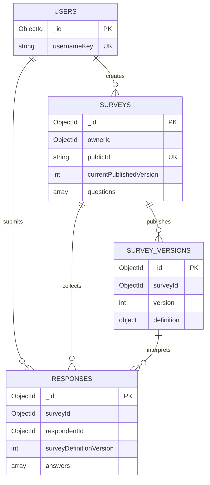

# 基于 MongoDB 的在线问卷系统

数据管理系统课程项目，第一阶段应用版本 **1.0.0**。系统支持账号管理、四种题型、条件跳转、发布与暂停、答卷提交、历史版本和分版本统计，全部业务数据存储在MongoDB中。

代码仓库：[Ziccc1/mongodb-survey-system](https://github.com/Ziccc1/mongodb-survey-system)。[作业要求核对与最新测试](docs/assignment-checklist.md)保留当日完成项、统计口径及报告收尾事项；2026-10-19另已整理[最终提交版AI日志](docs/ai/submission-log.md)。

本文件是项目运行及提交材料的统一入口，提供版本、配置、Schema及其关系、API和测试说明；详细文档均可返回本页。

## 目录

- [页面预览](#页面预览)
- [系统说明与文档导航](#系统说明与文档导航)
- [前后端版本与环境](#前后端版本与环境)
- [配置与启动](#配置与启动)
- [使用流程](#使用流程)
- [数据库集合与Schema](#数据库集合与schema)
- [API说明](#api说明)
- [关键逻辑](#关键逻辑)
- [测试用例与预期结果](#测试用例与预期结果)
- [项目目录](#项目目录)
- [当前范围与限制](#当前范围与限制)

## 页面预览

以下截图来自实际浏览器测试，使用独立测试库中的合成账号和样例问卷。工作台截图为新账号空态，统计示例中的答卷数量不是实际业务运营数据。

| 工作台 | 发布与收集 |
| --- | --- |
|  |  |

[查看编辑器、分页填写和分版本统计等更多页面](docs/ui-preview.md)。截图中的本机地址和测试端口只代表当时测试环境，实际启动地址以[配置与启动](#配置与启动)为准。

## 系统说明与文档导航

系统由浏览器、后端API和MongoDB组成。前端负责交互与展示，后端负责认证、权限和业务判断，数据库负责持久化及结构、唯一性、事务约束。前后端共享题型、校验和跳转计算逻辑。

| 文档 | 内容 |
| --- | --- |
| [系统总体设计](docs/system-design.md) | 架构、模块、页面、流程；保留设计沿革，结合当前实现说明阅读 |
| [数据库设计](docs/database-design.md) | 四集合完整字段、嵌套结构、类型、索引及版本关系 |
| [API说明](docs/api.md) | 路径、参数、认证、请求与响应、错误码、分页及示例 |
| [关键逻辑说明](docs/key-logic.md) | 跳转、校验、改答清理、版本发布、幂等、防重和统计 |
| [部署说明](docs/deployment.md) | 本机开发、局域网和构建后同源访问配置 |
| [测试用例与实际结果](docs/testing/submission-test-cases.md) | 36项用例的步骤、输入、预期/实际输出、结果及证据 |
| [人工执行证据](docs/testing/manual-execution-evidence.md) | 实际MongoDB查询及人工反馈，手机号已脱敏 |
| [完整人工验收方案](docs/testing/manual-acceptance.md) | 84项计划及固定数据，不等于全部已执行 |
| [项目实现摘要](docs/project-report.md) | 核心实现、完成范围与限制；历史增量按日期保留 |
| [AI记录入口](docs/ai/README.md) | [最终提交版日志](docs/ai/submission-log.md)、[补充提示词原文](docs/ai/submission-prompts.md)、历史过程及验证证据 |

## 前后端版本与环境

前端、后端和共享包项目版本均为1.0.0。依赖版本依据各级 `package.json` 与 `package-lock.json`，通过 `npm.cmd ci` 安装锁定依赖。

| 分类 | 组件 | 版本或要求 | 用途 |
| --- | --- | --- | --- |
| 运行环境 | Node.js | 已验证22.17.0；要求 `>=22.12.0 <23` | 后端、构建与测试 |
| 包管理 | npm | 已验证10.9.2；要求 `>=10 <11` | workspaces及依赖安装 |
| 前端 | Vue / Vue Router | 3.5.44 / 4.6.4 | 组件与路由 |
| 前端构建 | Vite / vue-tsc | 8.3.4 / 3.3.13 | 开发、构建和类型检查 |
| 图表 | ECharts | 6.1.0 | 选择题柱状图、饼图 |
| 后端 | Fastify | 5.12.7 | API服务 |
| 数据访问 | mongodb原生Node.js驱动 | 7.7.0 | 查询、BSON与事务 |
| 认证 | jose / @fastify/cookie | 6.2.12 / 11.1.3 | JWT与Cookie |
| 静态资源 | @fastify/static | 10.1.6 | 构建版前端资源 |
| 共享逻辑 | TypeScript / decimal.js | 5.9.3 / 10.6.0 | 类型、校验与十进制比较 |
| 数据库 | MongoDB | 已验证8.3.11；副本集 `rs0` | 业务持久化与事务 |
| 数据库终端 | mongosh | 已验证2.11.1 | 查询及核查 |
| 浏览器测试 | @playwright/test | 1.64.1 | 优先使用本机Edge |

启动脚本面向Windows PowerShell，要求 `mongod.exe` 在PATH中。浏览器通过API访问业务，不直接连接MongoDB。

## 配置与启动

当前尚未提供自动完成依赖安装、数据库初始化和前后端启动的完整一键脚本。`npm.cmd start`只启动已构建的后端及前端静态资源，需要先完成以下初始化并启动MongoDB。开发模式仍需分别运行API和Vite；不能直接双击HTML文件运行系统。

### 首次安装与初始化

在项目根目录执行，下方为本机路径示例，其他电脑替换为实际项目路径。

```powershell
Set-Location -LiteralPath 'D:\大三\数据库\project1'
npm.cmd ci
npm.cmd run configure
npm.cmd run db:start
npm.cmd run db:init
npm.cmd run build
```

- `configure`仅在 `.env` 不存在时创建配置及两个独立随机密钥，不覆盖已有文件。
- `db:start`使用项目专用 `.local/mongodb-rs0-v2`、27018端口和rs0；已运行时检查归属，不删除数据或重配未知实例。
- `db:init`创建缺失集合与索引或检查一致性，不执行未知旧库迁移。
- `build`构建共享包、后端及前端，首次开发启动前先完成，以提供共享包构建产物。

当前初始化通过 `npm.cmd run db:init` 使用 [Schema源码](apps/api/src/database/schema.ts)。`database/init-schema.js` 等旧脚本仅保留历史记录，不能作为当前版本初始化入口。

### 环境配置

模板见 [.env.example](.env.example)，实际 `.env` 留在服务器本机，不提交密钥。

| 配置项 | 开发默认值或生成方式 | 含义 |
| --- | --- | --- |
| `MONGODB_URI` | `mongodb://localhost:27018/project1_app_v2?replicaSet=rs0` | 连接地址、端口、数据库及副本集 |
| `MONGODB_DB` | `project1_app_v2` | 须与URI中的库名一致 |
| `APP_ORIGIN` | `http://localhost:5173` | 写请求允许的唯一浏览器Origin |
| `PUBLIC_APP_URL` | `http://localhost:5173` | 分享根地址，必须与APP_ORIGIN相同，无末尾斜杠或子路径 |
| `API_HOST` | `127.0.0.1` | 后端监听地址 |
| `API_PORT` | `3000` | 后端端口，开发代理同步读取 |
| `WEB_HOST` | `localhost` | Vite开发监听地址，前端端口固定5173 |
| `JWT_SECRET` | configure随机生成 | 认证签名密钥，至少48个字符 |
| `CURSOR_SECRET` | configure独立随机生成 | 分页游标签名密钥，至少48个字符，不能与JWT密钥相同 |

当前配置检查限定MongoDB为本机localhost/127.0.0.1、rs0，库名为 `project1_app_v2` 或 `project1_test_*`；接入其他数据库前需评估配置保护与数据迁移。

### 开发运行

两个PowerShell终端分别执行：

```powershell
npm.cmd run dev:api
```

```powershell
npm.cmd run dev:web
```

访问 **http://localhost:5173**，Vite将 `/api` 代理到 `http://127.0.0.1:3000`。地址须与APP_ORIGIN一致，不混用localhost和127.0.0.1；修改配置后重启相关服务。

### 构建版与分享访问

将 `.env` 中APP_ORIGIN和PUBLIC_APP_URL均改为 `http://localhost:3000`，执行：

```powershell
npm.cmd run build
npm.cmd start
```

访问 **http://localhost:3000**，由后端提供前端资源和API。切回开发时，两项地址恢复5173并重启服务。

localhost链接仅限本机。其他填写者无需安装项目，但需能访问承载服务的网络地址，详见[部署说明](docs/deployment.md)。尚未完成第二台设备和公网访问验收。前台服务用 `Ctrl+C` 停止，不通过删除数据库目录解决端口占用。

## 使用流程

1. 注册登录，通过工作台进入“创建问卷”或“我的问卷”。
2. 设置标题、说明、匿名/重复策略及截止时间，分别保存基本信息和题目。
3. 在题目列表底部连续添加单选、多选、文本、数字题，配置必答、选项、输入限制和向后跳转，题目与规则可调整顺序。
4. 浏览预览无需作答；模拟填写执行校验和跳转。两种预览均不新增正式答卷或计数。
5. 发布或重新发布成功后，自动进入“发布与收集”页面，首屏显示分享链接和复制按钮。编辑页顶部也可直接进入该页。填写者登录后按实际路径填写，每页最多10道有效题，保留原题号。改答后清理失效分支答案。
6. 正式提交后取得回执；结果未知时留在原页，以原请求标识、发布号和内容重试确认，不另发一次。
7. 查看整卷、单题、历史答卷和分版本统计，区分累计、当前版本及所选版本份数。
8. 修改前先暂停，保存后重新发布，原ID与链接保留，旧答卷按旧快照解释；关闭后不提供重开操作。

首次发布后匿名/重复策略锁定；禁止重复按整份问卷跨版本执行。匿名仅对创建者隐藏账号，内部仍关联登录身份。多选占比以该题有效回答份数为分母，合计可能超过100%。

## 数据库集合与Schema

当前业务库包含 **4个集合**。以下列出核心字段，完整必填字段与嵌套结构见[数据库设计](docs/database-design.md)，可执行验证器和索引见[Schema源码](apps/api/src/database/schema.ts)。

### 四个集合的核心结构

| 集合 | 核心字段及BSON类型 | 一份文档的含义 |
| --- | --- | --- |
| `users` | `_id: ObjectId`；`username/usernameKey/passwordHash: String`；`createdAt/updatedAt: Date`；`schemaVersion: 1` | 一个账号；规范化用户名唯一，保存密码哈希 |
| `surveys` | `_id/ownerId: ObjectId`；`publicId/title/description/status: String`；`allowAnonymous/allowRepeat: Boolean`；`expiresAt: Date或null`；`questions: Array`；`definitionVersion/revision: 整数`；`currentPublishedVersion: 整数或null`；`submissionCount/currentVersionSubmissionCount: 非负整数`；`schemaVersion: 2` | 稳定问卷身份、管理状态与可编辑定义 |
| `survey_versions` | `_id/surveyId/publishedBy: ObjectId`；`version/sourceDefinitionVersion: 整数`；`definition/policySnapshot: Object`；`definitionHash/publicationRequestId/publicationRequestHash: String`；`publishedAt: Date`；`schemaVersion: 1` | 一次正式发布的完整定义与策略快照 |
| `responses` | `_id/surveyId/respondentId: ObjectId`；`surveyDefinitionVersion: 整数`；`anonymous/repeatAllowed: Boolean`；`requestId/payloadHash: String`；`payloadHashVersion: 2`；`answers: Array`；`submittedAt: Date`；`schemaVersion: 2` | 一次成功提交的独立答卷 |

`schemaVersion`是文档结构版本，`definitionVersion`是编辑定义修订，`revision`用于管理操作并发检查。发布快照的 `version`、问卷的 `currentPublishedVersion`、答卷的 `surveyDefinitionVersion` 对应发布版本，不能混用。

### 题目与答案的嵌套结构

| 结构 | 主要字段 | 约定 |
| --- | --- | --- |
| 通用题目 | `id/type/title/required/jumpRules[]` | type为single、multiple、text、number，ID不依赖题序 |
| 选项 | `options[{id,label}]` | 单选、多选使用，答案引用选项ID |
| 多选校验 | `validation.minChoices/maxChoices` | 相等时为恰好选择指定数量 |
| 文本校验 | `validation.minLength/maxLength` | Unicode码点计数，纯空白视为未答 |
| 数字校验 | `validation.min/max: Decimal128`、`integerOnly: Boolean` | API数字字符串，数据库十进制类型 |
| 跳转规则 | `id/condition/targetQuestionId` | eq、containsAny/containsAll、lt/lte/gt/gte等，仅向后跳 |
| 单选答案 | `questionId/type/optionId` | 一个合法选项ID |
| 多选答案 | `questionId/type/optionIds[]` | 合法、不重复的选项ID数组 |
| 文本答案 | `questionId/type/text` | 非空回答保留原文 |
| 数字答案 | `questionId/type/number: Decimal128` | 0有效，API收发为数字字符串 |

题目嵌入 `surveys.questions` 与 `survey_versions.definition.questions`，答案嵌入 `responses.answers`。被跳过和可选未答不保存空答案。应用层最多100题，每道选择题2—100个选项，每题最多100条规则；其他长度与请求限制见API契约。

### 集合关系



图中仅列关系所需字段，未发布时currentPublishedVersion为null。MongoDB不自动提供关系型外键，下列引用由后端维护：

- `surveys.ownerId → users._id`：账号拥有问卷。
- `survey_versions.surveyId → surveys._id`：一份问卷有多个发布版本。
- `responses.surveyId → surveys._id`，`respondentId → users._id`：答卷关联问卷与内部账号。
- `(responses.surveyId, surveyDefinitionVersion) → (survey_versions.surveyId, version)`：复合关联决定历史答卷的题目含义。
- `(surveys._id, currentPublishedVersion)`指向当前快照；题目、选项和规则以稳定字符串ID在版本内关联。

题目和选项整体读取，因此嵌入；答卷持续增长，因此独立存储。各版本重复定义是有意冗余，用于保留历史语义。

### 索引、事务与数据核查

用户名、分享标识和问卷发布号均有唯一索引。答卷 `(surveyId, respondentId, requestId)` 唯一索引约束网络重试；当 `repeatAllowed=false` 时，`(surveyId, respondentId)` 部分唯一索引限制重复填写。查询索引支持创建者列表和版本历史分页。

发布在同一事务中插入快照、切换指针并重置当前计数；提交在同一事务中插入答卷并增加累计/当前计数。验证器保证字段与BSON类型，动态引用和路径规则由后端检查。

先在PowerShell连接：

```powershell
mongosh 'mongodb://localhost:27018/project1_app_v2?replicaSet=rs0'
```

以下命令在 **mongosh提示符中** 执行，不直接粘贴到PowerShell：

```javascript
db.getName();
db.getCollectionNames();
db.users.find({}, { passwordHash: 0 }).limit(5).pretty();
db.surveys.find({}, { title: 1, status: 1, currentPublishedVersion: 1, submissionCount: 1, currentVersionSubmissionCount: 1 }).limit(5).pretty();
db.survey_versions.find({}, { surveyId: 1, version: 1, publishedAt: 1 }).limit(5).pretty();
db.responses.find({}, { surveyId: 1, surveyDefinitionVersion: 1, anonymous: 1, submittedAt: 1 }).limit(5).pretty();
```

实际Schema类型、答案和计数核对见[人工证据](docs/testing/manual-execution-evidence.md)。数据库文档不直接作为业务响应，匿名信息由后端白名单过滤。

## API说明

完整参数、状态码与示例以 **[API文档](docs/api.md)** 为准。公共前缀为 `/api/v1`，同源Cookie认证，写请求检查Origin及 `X-CSRF-Guard`。

| 模块 | 方法及路径（省略公共前缀） | 功能 |
| --- | --- | --- |
| 账号 | `POST /auth/register`、`POST /auth/login` | 注册、登录 |
| 会话 | `GET /auth/me`、`POST /auth/logout` | 当前账号、退出 |
| 问卷 | `GET /surveys`、`POST /surveys` | 自己的列表、创建草稿 |
| 编辑 | `GET /surveys/:surveyId`、`PATCH /surveys/:surveyId`、`PUT /surveys/:surveyId/questions` | 读取、保存元数据及题目 |
| 发布状态 | `POST /surveys/:surveyId/publish`、`POST /surveys/:surveyId/pause`、`POST /surveys/:surveyId/close` | 发布、暂停、关闭 |
| 版本 | `GET /surveys/:surveyId/versions`、`GET /surveys/:surveyId/versions/:version` | 版本列表与定义 |
| 填写 | `GET /public/surveys/:publicId` | 获取当前发布定义 |
| 提交 | `POST /public/surveys/:publicId/responses` | 正式提交或确认原成功结果 |
| 历史 | `GET /surveys/:surveyId/responses`、`GET /surveys/:surveyId/responses/:responseId` | 历史列表与详情 |
| 统计 | 整卷、单题统计与填空原文分页GET接口 | 精确路径和版本/游标参数见API文档第11节 |

成功响应为 `{ "data": ... }`；错误响应为 `{ "error": { "code", "message", "details", "traceId" } }`（结构示意）。编辑携带expectedRevision，正式提交携带发布号及Idempotency-Key。身份、时间和计数由后端决定。可选复制接口未启用，返回501，页面无入口。

## 关键逻辑

完整说明见 **[关键逻辑文档](docs/key-logic.md)**。

| 逻辑 | 当前规则 |
| --- | --- |
| 跳转 | 从首题计算，顺序匹配第一条命中规则，只向后跳，无命中进入下一题 |
| 必答与分支 | 仅最终有效路径检查必答，改答后清理失效分支，保留仍有效回答 |
| 校验 | 前端预检、后端最终重算与校验、数据库结构及唯一性约束 |
| 保存与发布 | 保存更新编辑区，发布生成新快照，原ID与链接不变 |
| 版本统计 | 旧答卷按旧定义解释，默认最新版本，可切换历史 |
| 防重与幂等 | 问卷级限制重复，同key同内容返回原回执，同key不同内容冲突 |
| 状态与截止 | 暂停、关闭、到期、旧版页面拒新；成功请求仍可原样重放 |
| 匿名 | 内部关联登录身份，管理接口不返回账号关联、请求标识和摘要 |

## 测试用例与预期结果

正式提交材料为 **[测试用例与实际结果](docs/testing/submission-test-cases.md)**，36项逐项记录步骤、输入、预期输出、实际输出、结果及证据。以下是代表性摘要。

| 测试步骤 | 输入 | 预期输出 | 已记录结果 |
| --- | --- | --- | --- |
| 注册A/B并核查users | 不同用户名、合法密码 | 两个独立账号 | TC01通过，人工文档与账号回归 |
| B请求A的管理资源 | B身份、A问卷ID | 404，不泄露或修改数据 | TC05通过，以自动权限证据为主 |
| 配置多选跳转并提交 | 篮球+游泳，目标年龄 | 跳过建议题，不保存其答案 | TC10/TC19通过，人工规则与答卷 |
| 检查年龄范围0—120 | -1、0、120、121 | 0/120通过，-1/121拒绝 | TC15通过，反馈及自动边界专项 |
| 检查手机号样例 | 13800138000、小数、字母 | 整数精确Decimal128，小数/字母拒绝 | TC16通过，不附加11位或号段校验 |
| 丢提交响应后重试 | 同key、版本、内容 | 原回执，不新增答卷或计数 | TC24通过，API与浏览器专项 |
| 暂停修改再发布v2 | v1已有答卷、修改后发布 | 同链接，旧数据保留、统计分版 | TC27/TC28通过，人工及自动证据 |
| 事务内受控抛错 | 发布或提交中注入异常 | 关联写入全部回滚 | TC26通过，真实MongoDB验证 |
| 核对维护计数与实数 | 两份人工测试问卷 | 存储计数等于countDocuments | 主问卷累计3/当前1，重复问卷2/2，均一致 |

### 执行命令

按启动章节安装依赖、生成配置并启动数据库后，在项目根目录执行：

```powershell
npm.cmd run typecheck
npm.cmd run build
npm.cmd run test:phase1
npm.cmd run test:regression
```

test:phase1运行发布、路径、提交、统计、边界/并发、分页和真实浏览器；test:regression覆盖账号、编辑、字符计数及登录退出。优先使用本机Edge，无Edge时执行 `npx.cmd playwright install chromium`。图表专项为 `node scripts/run-check.mjs charts`。

### 证据与执行范围

- 最近归档的7个核心模块均为passed、exitCode=0；运行日期、原始日志和其他构建/回归结果由[正式用例](docs/testing/submission-test-cases.md)逐项链接。
- 自动测试使用独立 `project1_test_*` 库；人工分步测试在业务库使用明确命名的账号和问卷，两套数据分别核对。
- [自动输出与退出码](docs/testing/runs/)、[人工证据](docs/testing/manual-execution-evidence.md)、[界面分页测试](docs/testing/frontend-redesign.md)、[桌面测试](docs/testing/desktop-polish.md)分别保留，不将反馈冒充完整执行日志。
- [84项完整验收方案](docs/testing/manual-acceptance.md)是计划。`database/inspect-acceptance.mongosh.js`针对其固定样例，不直接套用到任意人工数据。
- 36项用例汇总整理时未重新测试；2026-10-18推送前另已执行类型检查、构建、7个核心模块、回归和图表测试，均通过，原始输出见[最新核对记录](docs/assignment-checklist.md)。结果仅对应相应代码及环境。

## 项目目录

```text
project1/
├─ README.md                 # 总入口
├─ .env.example              # 配置模板
├─ package.json              # workspaces、版本与命令
├─ package-lock.json         # 依赖锁文件
├─ apps/web/                 # Vue前端
├─ apps/api/src/core/        # 发布、版本、提交与统计
├─ apps/api/src/database/    # 当前Schema、索引与初始化
├─ packages/shared/          # 类型、校验、十进制与跳转
├─ scripts/                  # 配置、数据库启动、测试运行器
├─ tests/                    # 自动测试源码
├─ docs/                     # 系统、数据库、API与关键逻辑
│  ├─ testing/               # 用例、日志与截图
│  └─ ai/                    # AI日志、提示词和证据
└─ database/                 # 历史脚本与人工验收核查脚本
```

## 当前范围与限制

第一阶段的创建、编辑、预览、发布、填写、提交、统计及同链接版本化核心流程已完成。保留以下实际边界：

- 复制问卷、自动保存、跨刷新断点恢复、去重人数和跨版本合并不实现。待确认请求保留在当前页面内存中。
- 数字统计保留均值，手机号等题目默认隐藏均值；号码样例仅验证整数及精确存储。
- 当前MongoDB回环监听且未启用认证。应用仓储不提供快照修改/删除，数据库级只插角色尚未启用验收，不能阻止管理员改库。
- JWT退出清Cookie，未实现服务器令牌撤销；单节点不提供多节点高可用。
- 未知旧库迁移、第二台设备访问、生产负载和公网部署尚未完成验收。
- 历史设计与测试按日期保留，旧阶段状态不代表当前功能；当前结论结合本页、源码及实际结果核对。历史AI日志原文保留；2026-10-19已补充[最终提交版AI日志](docs/ai/submission-log.md)，成员贡献仍需本人复核。

[返回目录](#目录)
