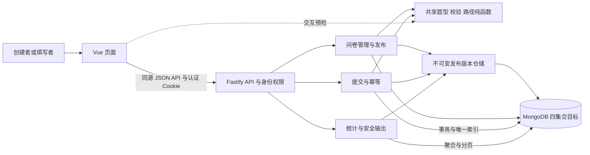
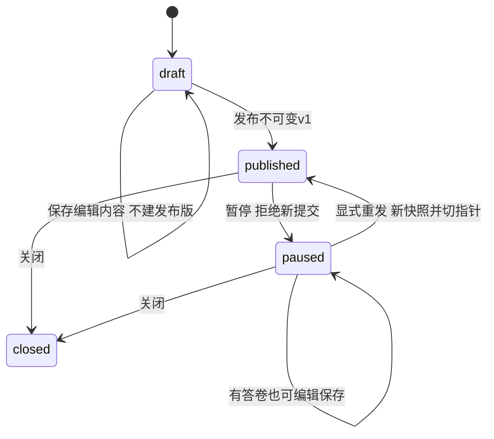

# MongoDB 问卷系统总体设计

[← 返回项目总 README](../README.md)


状态更新：2026-10-19。第一阶段核心功能已实现，代码、技术文档、AI材料及对应测试证据已推送GitHub。当前运行方式和功能范围以[项目README](../README.md)为准；本文件保留各阶段设计与验证背景，未执行的迁移、数据库角色及部署验证不标为完成。

原设计日期：2026-10-15。正式目录：`D:\大三\数据库\project1`。本文现作为已实现系统的总体设计说明；原设计阶段只编写文档的限制不代表当前尚无工程。

系统已完成创建、发布、登录填写、条件跳转、提交及统计闭环，使用users、surveys、responses和survey_versions四集合。账号、草稿、题目编辑、暂停修改后同链接重新发布、历史答卷与分版本统计均已实现。未知旧库迁移和数据库级快照角色尚未执行。字段及索引见[数据库设计](database-design.md)，详细HTTP契约见[api.md](api.md)，实际结果见[正式测试用例](testing/submission-test-cases.md)。[早期实现记录](implementation-verification.md)仅反映对应开发阶段，不代表当前全部实现范围。

## 1 阅读依据与要求等级

### 1.1 已核对的材料

完整读取了[原始作业要求](../大作业一.docx)正文和评分表、[需求清单](requirements.md)、[设计决策](decisions.md)、[数据库设计](database-design.md)、[平台调研](platform-research.md)、[历史验证记录](schema-verification.md)、[AI 记录规范](ai/README.md)、[AI 日志](ai/usage-log.md)、根目录 README、迁移清单，以及三个[数据库脚本](../database/init-schema.js)。脚本另外包括 [BSON 示例](../database/examples.js)和[验证脚本](../database/verify-schema.js)。

实际工程盘点：尚无 package.json、锁文件、前后端源码或框架配置；只有上述三个数据库 JavaScript 脚本。未发现适用的 AGENTS.md。原工作区 Git 元数据未迁入，正式目录当前没有 .git。本机只读检查得到 Node.js 22.17.0、MongoDB 8.3.11、mongosh 2.11.1；不把已安装命令等同于项目依赖已锁定。

### 1.2 三类依据

| 等级 | 内容 | 实施地位 |
| --- | --- | --- |
| 教师明确要求 | MongoDB 存储全部业务数据；禁用关系数据库及现成问卷框架；账号、问卷生命周期、三大题型、三类跳转、提交、统计、测试、文档、真实 AI 记录；两阶段连续迭代 | 必须满足，细项见 R01—R21 和原文 |
| 项目组已确认 | D01—D18当前规则：D06已修订；暂停可编辑已有答卷，原ID/链接重发、不可变版本、分版统计与计数、旧版拒新与成功重放；匿名/重复策略不扩展 | 本轮保持；最新指令明确暂不增加去重人数 |
| AI 技术建议 | 本文技术栈、路由、认证方式、目录、限制数值和工程操作；发布事务、快照字段、编辑修订映射、迁移与关闭终态等；匿名/重复策略本轮明确沿用原方案 | 明确推荐的实现基线，并非教师强制或已经过用户逐项确认；涉及业务影响的项目另见第 12 节 |

年龄 0—120、手机号整数、样例水果与性别选项是题型能力的示例，不意味着每份问卷必须包含这些题目。手机号整数示例按 D09 支持，不能推导为所有数字题都只能输入整数。“建议不要所有数据放一个集合”属于原文设计建议；保留三核心集合并新增发布版本集合是本项目的选择。无需论证关系数据库不能完成此系统，应说明本项目为什么适合当前文档模型。

## 2 范围与验收目标

### 2.1 第一阶段必做

注册登录；仅管理自己创建的问卷；标题、说明、匿名及重复设置；单选、多选、文本填空、数字填空；必答和数量、长度、数值、整数校验；可配置单选、多选、数字跳转；发布链接、截止、暂停和关闭；登录后顺序填写、返回改答、最终提交、多人并发填写；整卷及单题统计，文本内容分页查看、数字平均值。暂停后编辑保存与显式发布分开；保留不可变发布快照与所有旧答卷，同一链接继续使用。复制降为可选功能。

教师要求按[需求清单](requirements.md)验收；暂停、发布版本、并发控制、幂等是为落实当前已确认行为所需的方案；复制不再是修改必要步骤。简单可用的页面即可，不以复杂视觉效果作为交付前提。每次成功提交都必须持久化；拒绝非法输入不能产生半份有效答卷。

### 2.2 可选与暂不实现

| 分类 | 内容 | 边界 |
| --- | --- | --- |
| 可选增强 | 未提交答卷草稿、自动保存、断点恢复、复制问卷 | D08 已允许后评估；核心功能全部通过后再实施，不能把浏览器临时状态当 MongoDB 持久化 |
| 暂不实现 | 去重人数、文本条件跳转、向前题序回跳、提前结束目标、答卷提交后修改、问卷/答卷删除、上传题、复杂图表、协作编辑、第三方登录、邮件短信、密码找回 | 不作为第一阶段验收项；其中回跳限制来自 D05，其余多为本轮范围建议 |
| 第二阶段按新需求评估 | 更多题型、策略切换、跨版合并、统计缓存 | 不预先实现未知功能，保留结构与迁移路径 |

### 2.3 统计的措辞与边界

沿用有效答卷份数与选择次数，第一阶段不增加去重人数查询或界面。有效答卷是通过后端验证并完成事务提交的 responses 文档。重复填写允许时，每次主动提交分别计入；网络重试只计一份。

原文单选的“每个选项多少人选择、总共多少人回答”，在每人限填一次时与本方案的份数相同；允许同一账号多次填写时不再等价。因此界面与报告标明“回答份数”“选项选择次数”，不能标成独立参与人数，也不能宣称对原文“人数”的去重解释已经满足。该边界是已确认 D12 的项目口径，不是教师另行答复。

统计按发布版本分开，默认最新，可切换历史；累计/当前/所选版本份数分别标注，累计总数不代表跨版题目合并。未发布编辑内容不参与统计。统计只对所选版实际回答题目的答卷计分母，被跳过或可选留空不计入；多选各选项计数之和可能超过回答份数。无数字答案时平均值为 null；数值 0 参与平均。文本和数字原始内容分页查询，不在整卷汇总中一次返回全部内容。

## 3 推荐技术栈与兼容策略

### 3.1 明确推荐

没有既有应用栈需要迁就。本轮推荐统一 TypeScript，以共享题型、纯函数校验及路径计算，降低前后端解释分歧。保持 MongoDB 原生文档、Decimal128 和事务语义，不增加 ODM。

| 层次 | 推荐方案 | 理由及主要代价 |
| --- | --- | --- |
| 运行环境 | Node.js 22 LTS 受维护补丁，最低 22.12；当前 22.17 满足工具最低线 | 复用本机环境；初始化时更新到受维护补丁并锁定，最低可运行不等于补丁安全状态已审查 |
| 前端 | Vue 3、Vue Router 4、TypeScript、Vite 8；普通 CSS、原生表单控件 | 动态题目和编辑状态直观，组件量可控；仍需构建步骤及路由配置，不引入大型 UI 库 |
| 后端 | Fastify 5、TypeScript、ES modules | 路由校验、响应序列化、日志和 inject 测试集中；需要学习 schema 与插件配置 |
| 数据访问 | mongodb 原生 Node.js 驱动 7.x、现有 MongoDB 8.3.11、mongosh 2.11.1 | 直接映射已有脚本；手写仓储、转换和引用校验，没有 ORM 自动关联 |
| 输入校验 | Fastify JSON Schema/Ajv；共享纯函数负责动态业务校验 | 固定请求形状与问卷配置校验分层；API JSON Schema 不能直接复用含 bsonType 的数据库验证器 |
| 十进制 | decimal.js 10.x + 驱动 Decimal128 | 前后端以十进制比较，避免手机号/小数经 JS Number 损失精度；必须统一字符串转换与规范化 |
| 认证 | Node crypto 异步 scrypt；jose 6 签发短期 JWT；兼容 Fastify 5 的 @fastify/cookie（官方标注 >=10.x） | 不增加服务端会话存储，业务版本另存survey_versions；代价是退出清 cookie 后，已泄漏令牌在过期前不能单独撤销 |
| 测试 | node:test + tsx 执行纯函数与集成测试，Fastify inject 测 API，Playwright 1.x 跑必要浏览器流程 | 少引入一个单测框架；需在真实单节点副本集验证事务，不能用 mock 代替 |
| 工程工具 | npm workspaces、package-lock.json、tsc、vue-tsc、ESLint、Prettier、Git、PowerShell | 一个仓库和锁文件；提交依赖锁，使用 npm ci；本轮不安装或创建这些配置 |

TypeScript 基线建议 5.9.x，搭配兼容的 vue-tsc 和 Vite Vue 插件；具体补丁及间接依赖在工程初始化时核验并锁定，不把“当前最新版”写进可复现说明。若插件 peerDependencies 不接受这些组合，应修正工具版本，不更换已确认业务规则或数据库结构。

Vite 官方要求 Node.js 20.19+ 或 22.12+；Fastify 5 要求 Node.js 20+，当前选定 Node 22 满足两者。cookie 插件必须核对 Fastify 大版本，jose 6 采用 ESM；驱动兼容性在初始化时按官方矩阵和实际安装的 engines 再检查。保留当前 MongoDB 8.3.11，不在本轮升级服务器；团队演示与集成测试使用同版本副本集，不把单机验证结果外推为任意版本兼容。

### 3.2 校验与认证职责

后端固定请求结构校验与动态问卷业务校验分层；关闭静默移除未知body字段或类型转换，默认值由可信构造器提供。密码使用异步scrypt，账号身份采用短期JWT cookie；退出不宣称服务端立即撤销，匿名性由安全DTO而非前端隐藏保证。

具体cookie属性、Origin/CSRF头、TTL、用户名与密码约束、JSON协议和输出白名单统一维护在[API契约第2—4节](api.md#2-传输认证与统一规则)，不在本文件复制第二套参数。前端同源访问、后端不得记录密码/令牌/内部匿名身份的安全职责保持。

## 4 架构与职责



单体服务足够，逻辑模块分开，不拆微服务。所有持久化业务数据在 MongoDB，不引入 SQL、Redis、现成问卷引擎；配置、源码和测试证据文件不属于问卷业务数据。

| 责任 | 前端 | 后端最终保证 | MongoDB 保证 |
| --- | --- | --- | --- |
| 账号认证 | 展示登录状态、会话失效提示 | 凭据验证、签名验证、当前账号 | 用户文档结构、用户名唯一 |
| 问卷管理与版本 | 编辑/正式发布分开、版本标签 | ownerId、状态与revision；快照不可变及发布key | 单文档CAS、版本唯一键、快照与指针事务 |
| 校验与跳转 | 即时提示、下一题与返回改答 | 完整验证答案、从起点重算路径 | 基本形状与类型，不理解问卷动态规则 |
| 提交 | 冻结提交快照、重试同一请求 | 可信字段构造、幂等比对、状态与截止检查 | 部分唯一索引、幂等唯一索引、跨文档事务 |
| 统计与匿名 | 版本切换、累计/当前/所选份数 | 创建者权限、版本过滤、历史解释、匿名白名单 | 按问卷与发布号聚合，不跨版合并 |

浏览器预检是便利措施，绕过网页直接请求 API 仍必须被正确验证；DB 通过结构校验不等于业务通过。

## 5 页面与交互

### 5.1 页面清单

| 页面 | 主要操作 | 权限 | 加载、空状态和错误 |
| --- | --- | --- | --- |
| /login、/register | 登录注册，成功后返回原填写链接或问卷列表 | 未登录可访问 | 提交中禁重复点击；用户名冲突、凭据错误、网络重试；密码不回显 |
| /surveys | 查看自己的问卷、创建草稿、复制链接、进入统计 | 已登录 | 列表加载、暂无问卷提示、游标加载更多、加载失败重试 |
| /surveys/:surveyId | 编辑区题目与配置；保存草稿、预览、显式发布、暂停、关闭；复制可选 | 创建者 | 首次加载；无权限/不存在统一 404；保存冲突保留本地编辑；展示编辑修订/最新发布号/未发布改动；暂停后有答卷也可编辑 |
| /surveys/:surveyId/preview | 默认按原题序每页10题浏览；可切换模拟填写检查分支 | 创建者 | 分页浏览无需作答、不执行跳转；模拟填写执行校验和跳转；切换方式回到第一页，两种方式均不写 responses、不计统计 |
| /surveys/:surveyId/publication | 发布成功后的分享与收集管理，编辑页顶部可直达 | 创建者 | 首屏显示链接与复制按钮；刷新读取实际状态；暂停/关闭不再显示收集中；发布结果未知时留在原页重试，确认成功后才跳转 |
| /survey/:publicId | 登录后加载定义、按路径填写、匿名选择、最终提交 | 任意已登录用户，不要求是创建者 | 无效链接、未发布、暂停、已关闭、已截止、已提交限制、版本变更、网络错误分别提示 |
| /survey/:publicId/complete | 提交成功与回执；允许重复时开始新一次填写 | 提交者的当前页面状态 | 仅在服务器确认成功后显示；不通过 URL 泄漏账号或答案 |
| /surveys/:surveyId/statistics | 默认最新版本，可切历史；整卷/单题与原文分页；累计和当前份数分列 | 创建者 | 无答卷显示 0 次、无数字均值显示“暂无”；请求错误重试；无权限统一 404 |

编辑界面无需拖拽，可用“上移/下移”；规则优先级同样上下调整。移动或删除题目后即时标出失效引用，发布前统一检查。编辑和预览读surveys编辑区；填写与历史预览读取选定survey_versions快照，未发布修改不向填写者泄漏。已有版本内ID不改写；新版本可以保留同题ID但不得跨版本混用其定义。未经保存的题目、选项与规则由前端生成稳定 UUID，后端验证格式与唯一性；问卷、用户、答卷主键和 publicId 由后端生成。

### 5.2 填写与返回改答

以一题一步为推荐交互，每步提供上一题、下一题、进度说明。上一题沿实际已访问路径返回，不等于配置自动回跳；不得为跳过题强制补答。进度按当前路径表达，不承诺在未来跳转未确定前给出精确最终百分比。

修改早期答案后重算路径，清除不再属于路径的旧答案，并提示“因前面的回答变化，部分后续答案已清除”。仍在有效路径的答案可保留；后端再次重算并清除失效分支。非必答可跳过，已填写则执行限制。最后显示提交确认，不将“下一题”隐式当作正式提交。

匿名开关只在问卷允许时出现，建议默认开启并明确提示“系统内部关联登录账号，问卷创建者看不到该账号；回答内容本身可能包含你主动填写的身份信息”。默认匿名是本轮交互建议，不把它写成原 D01 已确定的默认值；未允许匿名则说明按实名方式记录。

### 5.3 提交与网络重试

点击提交生成随机 requestId，冻结版本、anonymous、有效答案快照，写请求使用 Idempotency-Key 头。提交中禁重复点击。超时或 503 代表结果未知，保留同一快照与 requestId，按钮显示“重试确认提交”，不能换 key 再提交。服务器确认成功后才清空状态；允许重复时“再次填写”建立全新快照与 key。

明确收到未写入的422校验失败后可改答并生成新key；SURVEY_VERSION_CHANGED表示该新请求未被接受，提示重载最新定义并重新作答，不自动把旧答案映射到新题；结果未知的旧请求仍先用原key确认是否已成功，不能直接丢掉原快照。结果未知期间不得改动正在重试的内容；会话过期可弹出登录对话后重试相同快照，不自动跳走丢失状态。第一阶段在页面内存保留填写和待提交快照；刷新/关闭可能丢失，应提示，跨刷新恢复属于可选 D08，不冒充已实现的自动保存。

## 6 API 接口概览

详细且唯一维护的HTTP合同见[API接口契约](api.md)：统一认证、请求头、原子类型、DTO、完整参数、错误、成功/失败示例与连贯生命周期。本文只保留模块与路径概览，不再维护第二份字段表或请求示例。第一阶段核心接口已实现；可选复制接口未启用，返回501且前端没有入口，具体范围以api.md开头的实现状态为准。

沿用`/api/v1`；创建者用内部surveyId管理，登录填写者用publicId；编辑修订、发布号与并发revision分开。状态/版本/事务业务依据仍见第7节及版本变更计划，协议细节以api.md为准。

| 编号 | 方法与路径（前缀/api/v1） | 用途与权限 |
| --- | --- | --- |
| [A01](api.md#a01-注册) | POST /auth/register | 注册；公开 |
| [A02](api.md#a02-登录) | POST /auth/login | 登录；公开 |
| [A03](api.md#a03-读取当前账号) | GET /auth/me | 读取当前账号；登录用户 |
| [A04](api.md#a04-退出登录) | POST /auth/logout | 退出登录；公开（仍校验写请求Origin/CSRF） |
| [Q01](api.md#q01-自己的问卷列表) | GET /surveys | 自己的问卷列表；登录用户 |
| [Q02](api.md#q02-创建问卷草稿) | POST /surveys | 创建问卷草稿；登录用户 |
| [Q03](api.md#q03-问卷编辑详情) | GET /surveys/:surveyId | 问卷编辑详情；创建者 |
| [Q04](api.md#q04-保存元数据与运行配置) | PATCH /surveys/:surveyId | 保存元数据与运行配置；创建者 |
| [Q05](api.md#q05-整体保存题目) | PUT /surveys/:surveyId/questions | 整体保存题目；创建者 |
| [V01](api.md#v01-正式发布) | POST /surveys/:surveyId/publish | 正式发布；创建者 |
| [V02](api.md#v02-暂停收集) | POST /surveys/:surveyId/pause | 暂停收集；创建者 |
| [V03](api.md#v03-关闭收集) | POST /surveys/:surveyId/close | 关闭收集；创建者 |
| [V04](api.md#v04-可选复制问卷) | POST /surveys/:surveyId/copy | 可选复制问卷；创建者；仅capabilities.copySurvey=true可用 |
| [V05](api.md#v05-发布版本列表) | GET /surveys/:surveyId/versions | 发布版本列表；创建者 |
| [V06](api.md#v06-读取历史发布定义) | GET /surveys/:surveyId/versions/:version | 读取历史发布定义；创建者 |
| [F01](api.md#f01-读取当前填写定义) | GET /public/surveys/:publicId | 读取当前填写定义；登录用户（非创建者也可） |
| [F02](api.md#f02-提交答卷或确认原成功结果) | POST /public/surveys/:publicId/responses | 提交答卷或确认原成功结果；登录用户 |
| [H01](api.md#h01-按版本列出历史答卷) | GET /surveys/:surveyId/responses | 按版本列出历史答卷；创建者 |
| [H02](api.md#h02-历史答卷详情) | GET /surveys/:surveyId/responses/:responseId | 历史答卷详情；创建者 |
| [S01](api.md#s01-整卷分版本统计) | GET /surveys/:surveyId/statistics | 整卷分版本统计；创建者 |
| [S02](api.md#s02-单题分版本统计) | GET /surveys/:surveyId/questions/:questionId/statistics | 单题分版本统计；创建者 |
| [S03](api.md#s03-填空原文分版本分页) | GET /surveys/:surveyId/questions/:questionId/answers | 填空原文分版本分页；创建者 |
| [Z01](api.md#z01-存活探测) | GET /health/live | 存活探测；公开 |
| [Z02](api.md#z02-就绪探测) | GET /health/ready | 就绪探测；公开 |

H01为本轮必要补缺：已有历史详情接口缺少responseId发现入口，因此增加创建者按版本分页列出历史答卷；仅只读元数据，不增加账号检索、改答或删除。页面覆盖与理由见[契约第13节](api.md#13-页面覆盖与缺口处理)。复制V04仍可不实现，不作为暂停修改的前提。

## 7 数据核对与关键流程

### 7.1 保留 Schema 与已知能力边界

保留三核心集合，专用新库已增加survey_versions；新版初始化为npm run db:init。完整字段/索引以[数据库设计](database-design.md)为准；旧[init-schema.js](../database/init-schema.js)继续保留且不升级，不作为当前入口。当前Q04/Q05编辑能力与真实验证见[编辑增量](editor-verification.md)，发布、答卷提交和分版本统计均已实现并有对应测试记录；未知旧库迁移仍未执行。

目标数据库保证形状、类型、唯一键；后端保证归属、引用、规则、路径、快照策略一致、状态与版本接受资格。新快照插入后不可变需仅find/insert权限、仓储边界及测试，普通JSON Schema不会自动实现不可变；legacy字段structureLocked保留但退出编辑判断。快照插入与发布指针、答卷与累计/当前计数分别由事务原子保证。

### 7.2 保存与发布检查

当前前后端共享题型schema、硬约束与validationIssues检查；草稿保存可容许尚未完整的题目业务配置，但仍必须满足现有 DB 基础形状，例如选择题至少两个选项、题干非空；前端未完成题目先保留本地状态而不是假装保存成功。发布前必须通过全部动态检查：

1. 至少一题，标题非空；题目与选项有稳定 ID，数组内无重复。
2. 单选/多选选项完整；最小值不大于最大值，选择数量不超过选项数；必答多选不能配置最多 0 项；必答文本不能配置最多 0 字。
3. 数字规则与跳转阈值可精确转 Decimal128、为有限值；integerOnly 与边界组合至少允许一个整数。
4. 单选规则引用当前选项，多选包含集合非空、选项存在；数字只允许既定比较符；文本无跳转规则。
5. 目标题目存在且位置严格在当前题后；删题、移动后重新检查；发现重叠规则提示首条优先，不擅自改优先级。
6. owner与draft/paused状态正确、预期revision及draftDefinitionRevision正确、截止尚未到达；不以已有答卷或legacy永久锁字段阻止发布。
7. 工程建议上限：100 题、每题 100 选项、每题 100 条规则、单个文本答案最多 10,000 码点、请求体 2 MiB、问卷 BSON 2 MiB。业务约束仍可更小；界面解释限制，发布检查不超 MongoDB 16 MiB 硬上限。这些数值是本轮可调整技术建议，不是教师要求。

当前保存已落实owner+revision的单文档CAS、无变化不增号、标题/说明/题目改变才增编辑修订、Decimal128转换与同值比较；失效引用保留并反馈。冲突时页面保留本地编辑，明确比较后手动选择。没有自动保存或自动发布。

### 7.3 状态与版本



问卷ID和publicId不变。暂停期间编辑区可变化，最后发布指针与历史快照不变；每次成功显式发布分配新发布号，同次发布重试不增号。closed终态仍沿用技术建议，本轮不扩展重开，截止不删数据。

definitionVersion保留为编辑内容修订；API管理端称draftDefinitionRevision；revision是管理CAS；currentPublishedVersion只在正式发布切换，API填写端称publishedVersion。首次发布前指针null；snapshot.sourceDefinitionVersion记录来源修订。首次提交不再永久锁结构，旧structureLocked原值保留但新代码不据其授权。

### 7.4 校验与路径计算

先区分已成功幂等重试与新提交；新提交验证状态/当前发布号后，按对应快照检查题目，不能拿草稿或新版本验证旧成功重放。提交检查请求形状、题目ID与答案类型，拒绝未知题目、重复题目答案、非法选项、多选重复值和不可解析数字。随后从第一题开始：取当前答案、按 required 和 validation 检查、按 jumpRules 顺序选第一条命中、否则下一题，直到末尾。可选未答不命中任何条件。只对最终经过的题执行内容限制；合法形状但不在最终路径的旧答案丢弃。结果为有序路径与其非空答案，不能相信客户端提交的 visitedQuestionIds。

纯空格文本视为未答，非空保留原始内容，长度按 Unicode 码点；min=max 表达恰好选择；0 是有效数字；整数校验比较数学整数性，不执行 parseInt 截断。Decimal128 精确转换失败须报错，前后端使用同一纯函数规则，后端为准。

### 7.5 事务提交与幂等

详细流程引用[版本变更计划第3—4节](versioning-change-plan.md#3-原子发布与不可变性)。继续使用真实副本集、驱动withTransaction、snapshot/majority/primary；所有操作同session，callback内无不可回滚副作用。

正式发布：先查Publication-Key的原操作指纹；未成功过才核对编辑修订和状态，事务插不可变版本并CAS切问卷指针、当前计数归0；旧累计/答卷/快照不变。普通编辑保存只更新编辑定义，不走版本插入。

提交：先按surveyId/respondentId/requestId找成功记录，用其历史快照与原算法比对，原版本同内容直接返回原回执。无记录才要求published、未截止、请求publishedVersion等于当前指针；旧号返回409 SURVEY_VERSION_CHANGED并提示重载。事务按当前快照核验路径、CAS实际更新问卷累计和当前计数，再插答卷，关联该发布号。不更新不可变快照，不再写永久结构锁。

原防重复与幂等唯一索引都不增加版本维度，避免不允许重复的人每次发布都重新获得资格或同key改版变成新请求。暂停/发布/提交写同一问卷，写冲突保护接受边界；已成功请求重试在暂停、关闭、过期、重发后仍返回原结果，计数不动。驱动及未知结果重试仍保留原key，重复键分原因处理。

### 7.6 统计流程

先owner验权，再固定selectedVersion（省略时取currentPublishedVersion），读该快照并按surveyId+surveyDefinitionVersion过滤答卷。题目标签、0次选项、校验及历史原文只能来自该版；同题ID不代表不同版本语义可合并。

累计所有版本份数、当前发布版份数和所选版本份数分别返回；不增加去重人数，不跨版合并选项/均值。只读snapshot事务建议确保同一统计中的发布指针与份数一致；游标绑定问卷/版本/题目，切换版本重新第一页。完整口径见[数据库设计第10节](database-design.md#10-统计口径和示例查询)和[版本计划第5节](versioning-change-plan.md#5-历史读取统计与计数)。

## 8 工程结构与运行方案

> 2026-10-16实施说明：工程已创建；当前可执行步骤以[README](../README.md)为准，使用npm run db:start和db:init。下列旧手工MongoDB命令属于最初方案记录，不作为新版启动入口；不要运行旧init-schema.js初始化本版。

版本化新增职责：surveys模块区分编辑保存/正式发布，新增只插入/读取的版本仓储；submissions按快照验证，statistics显式版本过滤；database/migrations未来落实migration-002。下方保留原设计阶段的目录建议；工程现已创建，实际职责布局见README。旧库迁移仍待落实。

### 8.1 推荐目录

以下为2026-10-15的目录建议，不是当前文件清单；实际工程使用packages/shared和apps/api/src/core等目录，完整现状见README“项目目录”：

```text
project1/
  README.md
  docs/                         # 需求、决策、总体、数据库、证据与 AI 日志
  database/                     # 已有初始化、示例、验证；未来增加 migrations/
  apps/
    web/src/
      pages/ components/        # 页面与简单题型/编辑控件
      api/                      # fetch 封装、错误和 cookie 请求
      state/                    # 登录状态、编辑和答题内存状态
    api/src/
      app.ts server.ts          # 可注入测试的应用工厂与监听入口
      plugins/                  # DB、cookie、认证、日志、限速
      modules/
        auth/ surveys/ submissions/ statistics/
      repositories/             # MongoDB 查询及带 session 的写操作
      serializers/              # API DTO、Decimal128 与匿名白名单
      config/                   # 环境变量校验
  packages/domain/src/          # 题型、API 类型、动态校验、路径纯函数
  tests/unit/ integration/ e2e/  # 纯函数、真实副本集/API、浏览器
  scripts/                      # 未来开发、迁移、显式 demo 数据工具
  .env.example                  # 只有示例值，无密码密钥
  package.json package-lock.json tsconfig.json
  .local/                       # 被 Git 忽略的本地 DB 和运行日志
```

共享 domain 不依赖 Vue、Fastify 或数据库连接；MongoDB BSON 转换仅在后端适配层，浏览器使用字符串。modules 调用 domain 与 repositories，路由不散落拼 MongoDB 查询。单个 MongoClient 连接池由应用管理，关闭服务时释放，不每个请求重连。

### 8.2 配置与启动顺序

| 配置 | 示例或作用 |
| --- | --- |
| NODE_ENV | development/test/production |
| API_HOST / API_PORT | 127.0.0.1 / 3000 |
| APP_ORIGIN | http://localhost:5173；交付运行用实际同源地址 |
| MONGODB_URI | mongodb://localhost:27018/survey_project?replicaSet=rs0 |
| MONGODB_DB | survey_project，须与 URI 预期一致；启动检查禁止误接测试库/生产库 |
| JWT_SECRET / JWT_ISSUER / JWT_AUDIENCE | 随机强密钥及固定签发/接收标识，禁止示例值运行正式环境 |
| AUTH_TTL_SECONDS / COOKIE_SECURE | 推荐 7200；Secure 随 HTTPS 配置，不能把本地 HTTP cookie 错设成无法发送 |
| LOG_LEVEL / BODY_LIMIT_BYTES | info / 2097152；配置经过类型和范围检查 |
| TEST_MONGODB_URI / TEST_DB_PREFIX | 真实测试副本集 URI；独立显式前缀，不复用业务库 |

前端只使用同源 /api，不把 MongoDB URI、JWT_SECRET 作为 VITE_* 变量打包。所有工作目录都先切到项目根目录。下面 MongoDB 命令可供未来配置时使用，本轮未执行：

```powershell
Set-Location -LiteralPath 'D:\大三\数据库\project1'
# 首先确认 27018 未被使用，并使用全新的专用目录；不要指向旧 standalone 数据目录。
New-Item -ItemType Directory -Path '.local\mongodb-rs0' -Force
# 在专用终端前台运行，保持终端开启；若 mongod 不在 PATH，使用本机实际可执行路径。
mongod --dbpath 'D:\大三\数据库\project1\.local\mongodb-rs0' --replSet rs0 --bind_ip localhost --port 27018
```

新终端执行一次初始化，已经配置的副本集只检查，不重复 initiate：

```powershell
mongosh 'mongodb://localhost:27018/admin?directConnection=true' --eval 'rs.initiate({_id:"rs0",members:[{_id:0,host:"localhost:27018"}]})'
mongosh 'mongodb://localhost:27018/admin?replicaSet=rs0' --eval 'db.hello().isWritablePrimary'
Set-Location -LiteralPath 'D:\大三\数据库\project1'
mongosh 'mongodb://localhost:27018/survey_project?replicaSet=rs0' --file database/init-schema.js
```

等待 primary 检查返回 true，再运行 schema 初始化和应用。单节点副本集是本地事务环境，不提供高可用；只绑定本机，不将此无账号示例当公网部署方案。不删除、清空或改造已有实例，端口冲突另选专用端口并同步副本集 host 与 URI。

工程初始化阶段需实现并在 README 验证的 npm 命令合同：首次锁定依赖后用 npm ci；npm run dev:api 和 npm run dev:web 分别启动两个终端；npm run typecheck、npm test、npm run test:integration、npm run test:e2e 验证；npm run build 后 npm start 同源提供页面与 API。当前 package.json 不存在，这些命令尚不可运行，本轮不声称已启动网站。

### 8.3 初始化、示例与测试数据

现有init-schema.js只创建旧三集合与索引，不支持本轮新增字段/快照；后续先编写新版初始化与独立migration-002，ready按四集合检查。旧验证器不匹配时报错，不能偷偷覆盖；schema 一致可重复运行，但初始化涉及多个集合，不声称整段脚本是一个原子事务。执行失败需检查已创建的集合再按迁移流程处理。

examples.js 仅定义 schemaExamples，不自动插入。其 passwordHash 和 payloadHash 为占位符；verify-schema.js 直接插入样例，未同步 submissionCount/structureLocked，故不能把这些样例导入业务库作为真实可登录演示或事务一致性证据。未来 demo 工具应在显式 demo 库通过注册、发布、提交 API 生成真实哈希和正确状态，并标记样本来源。

现有 schema 检查可在全新库执行：

```powershell
Set-Location -LiteralPath 'D:\大三\数据库\project1'
$schemaTestDb = 'survey_schema_check_' + (Get-Date -Format 'yyyyMMddHHmmssfff')
mongosh ("mongodb://localhost:27018/" + $schemaTestDb + "?replicaSet=rs0") --file database/verify-schema.js
```

脚本要求库名前缀及空库，测试数据保留，不清库。本例为操作说明，未在本轮运行。原历史测试数据仍位于旧工作区，迁移清单是当次复制快照，不能因本轮新增文档而伪造重新校验全部迁移的记录。

## 9 测试与验收追踪

> 当前账号/草稿已通过本轮类型、构建、13项集成子检查与浏览器流程，见[实现验证记录](implementation-verification.md)。以下完整阶段的其他测试仍按原计划执行，不将基础检查扩称为版本化验收。

### 9.1 计划测试

以下关联现有 R/T 编号，不另造已经通过的业务测试。每例按[需求清单测试格式](requirements.md#测试记录格式)记录前置、步骤、输入、预期、实际、执行人和证据。

| 模块 | 需求 / 测试 | 最低完成证据 |
| --- | --- | --- |
| 账号与权限 | R01—R02 / T01—T02 | 注册重名并发、凭据错误、登录失效、A 管不了 B 的详情/统计/修改、分享填写不受 owner 限制 |
| 问卷与状态 | R03—R05、R22—R25 / T03—T05、T22—T25 | 暂停有答卷可改、保存不发布、快照不变、同链接重发；版本与revision冲突 |
| 题型与校验 | R06—R09 / T06—T09 | 必答、可选空、多选最少/最多/恰好、长度边界、0、负数、小数、手机号整数、大整数精度、NaN/Infinity 拒绝 |
| 路径与改答 | R10—R13 / T10—T13 | 三类跳转、首条命中、无命中、非法目标和回跳拒绝、跳过必答不报错、改答失效答案清理 |
| 提交与匿名 | R14—R17 / T14—T17 | 成功保存、不同人并发、同人重复禁止/允许、伪造策略字段拒绝、同 key 同内容/异内容、关闭后已成功重试、匿名 API 无身份 |
| 统计 | R18—R21、R26—R27 / T18—T21、T26—T27 | 手算分版本答卷、累计/当前/所选份数、默认/历史、无跨版合并和去重人数、原文分页及权限 |

事务专项继续覆盖T14、T15、T17，新增T28—T35检查暂停/重发/提交竞态、发布事务与发布幂等、旧成功重放、政策跨版不变、迁移保留和异常门禁。[新增测试计划](test-plan.md)保留原编号和预期；发布、提交、分版本统计及事务等核心场景已有[实际测试证据](testing/submission-test-cases.md)，不能据此把原T22—T35整份计划全部标为通过。旧12项Schema检查的历史范围不变，迁移专项仍未执行。浏览器端至少演示创建发布、分支改答、匿名提交和统计闭环；低层 mock 不算事务通过。

### 9.2 实际已通过与本轮验证

[schema-verification.md](schema-verification.md)记录 2026-10-15 在旧工作区独立 MongoDB 8.3.11 实例进行的 12 项检查：结构样例、重复初始化、用户名唯一、单次填写索引、允许重复、请求 key 去重、策略字段必填、数字类型、多选去重、答案形状、数字均值、内部匿名关联。那是 schema/索引/聚合检查，未跑完整后端、匿名 DTO、并发压力、路径引擎或事务。

AI-009的文档静态检查保持其历史证据。AI-010同步版本化设计；2026-10-16的AI-011另整理API契约及文档检查/保护hash；不重新执行历史12项、不跑新业务或迁移测试、不安装依赖。证据分别保留，不能将新设计追写成过去已通过。

## 10 实施顺序与交付

| 步骤 | 范围 | 完成标准 |
| --- | --- | --- |
| 1 | 工程骨架、副本集与迁移准备 | 推荐栈、锁版本、配置检查、独立测试库；四集合验证器/版本契约和migration-002 dry-run准备；未核验不切真实写入 |
| 2 | domain 与账号 | 四题型契约、Decimal 转换、纯函数校验/路径用例；注册登录、身份中间件、跨用户访问测试 |
| 3 | 问卷管理与发布版本 | 保存/发布分离、已有答卷暂停编辑、不可变快照及指针事务、历史读取；复制仅可选；T22—T25、T32 |
| 4 | 正式提交 | 按发布号接受、旧版拒新、历史成功重放、双计数、防重、匿名；T14—T17、T28—T32 |
| 5 | 分版统计 | 固定版本手算、默认/历史切换、累计/当前/所选份数、原文游标；T18—T21、T26—T27、T35 |
| 6 | 简单页面串联 | 列表、编辑、预览、填写改答、重试、统计完整可演示；必要 Playwright 流程通过 |
| 7 | 阶段一交付 | 新环境按 README 启动，代码/schema/文档/报告/测试/AI 日志齐全；版本及证据归档 |

可以每步制作最小页面帮助演示，不能在后端还未保证权限和事务时宣称页面跑通即完成。计划步骤是依赖顺序，没有伪造个人分工或截止日期。

阶段一完成时在正式目录建立项目 Git 历史，保存锁文件、README、schema、报告、测试与 AI 日志；创建标识明确的 stage1-v1.0 标签，记录提交 hash。没有 .git 的当前状态不等于已经提交，初始化或打标签在后续实施时执行。提交前完善 .gitignore，排除 .env、node_modules、构建输出、.local 数据库文件和敏感信息。

样例通过可复现 fixture 或 demo API 生成；需要备份时 mongodump 到带日期的明确路径，保留数据库版本、schemaVersion、定义版本及恢复说明，在独立库试恢复。测试证据保存在 docs/test-evidence/，包括命令、实际输入输出、运行环境、关联 T 编号，不能只贴“通过”。本轮不备份、不迁移、不删除数据。

## 11 第二阶段兼容演化

同链接不可变发布版本已成为本阶段正式需求，不能仍写成“第二阶段才考虑”。保留三核心集合并增加survey_versions，新增字段/索引/验证器均通过增量迁移。迁移如何保留旧structureLocked、definitionVersion、版本关联号和hash，及快照缺失时阻断切换，见[版本变更计划第6节](versioning-change-plan.md#6-非破坏性迁移计划)。

第二阶段继续扩展现仓库与集合，保留旧发布快照、答卷和回归集。schemaVersion表示格式，编辑修订与发布号分开。策略切换、跨版统计、改已提交答卷和重开仍需另行需求及迁移设计；不删库重建，不把最新questions覆盖为历史定义。

## 12 发现的差异与处理

| 旧位置或规则 | 当前处理 | 状态 |
| --- | --- | --- |
| 旧D06：有答卷锁结构，修改必须复制 | D06正式修订，暂停可编辑、原ID/链接重发；复制可选 | 文档及核心业务已实现，实际证据见正式测试用例 |
| 原database-design第4/9节：structureLocked永久true、submissionCount=0才编辑 | 字段原值保留，旧准入谓词退出；编辑看状态/owner/revision，发布快照只读 | 目标设计已改，现有脚本/历史证据未改 |
| definitionVersion曾兼作提交版本 | 继续表示编辑修订；新增currentPublishedVersion；responses关联不可变发布号 | 迁移保留老编号，不全部重写为1 |
| 原system-design第11节：版本集合是未来可选 | survey_versions成为本阶段必要增量，三核心集合不替换 | 仅设计，未创建新集合 |
| 原整卷统计仅按surveyId，只有submissionCount | 所有题目统计按版本；累计/当前/所选版份数分列，不合并不去重 | API、索引和界面已实现；按发布版本统计 |
| 新版本发布后用当前题目验证旧重试 | 成功key优先查历史答卷及快照，原版本同内容返回原回执 | 新提交才检查最新号，专项T29/T30 |
| 原匿名/重复策略 | 本轮明确沿用，不加修改能力；防重索引跨版本 | 不改成每版可填一次 |
| 历史平台调研、AI-001—AI-009、旧12项Schema验证 | 保留原文和时间边界，历史锁定结论不当现行规则 | 本轮只追加AI-010；未重测 |

字段字典见数据库设计，流程/迁移见版本变更计划；正式行为来自用户八项决定，版本字段、发布key、快照只插权限和迁移细节是AI设计建议。closed终态和界面默认匿名仍沿用此前技术建议，本轮不借版本修改扩大其能力。

## 13 AI 使用记录与文档维护

沿用[AI规范](ai/README.md)，已追加AI-010版本设计记录，本轮另追加AI-011接口契约整理记录，不改写旧日志与测试事实。明确标注普通接口细节由AI提出、沿用的已确认规则、必要只读列表补缺、实际文档检查，以及没有业务/迁移/API执行。

字段维护入口：requirements保存功能编号，decisions保存已确认行为，database-design维护存储模型，versioning-change-plan维护版本流程与迁移，api维护HTTP参数/DTO/错误/示例。总体设计保留概览并引用，避免复制第二套契约。

## 14 技术资料

查阅日期为 2026-10-15；以下用于版本和机制核对，不代表已安装或运行通过。

- [Vue 快速开始](https://vuejs.org/guide/quick-start.html)、[Vite 入门与 Node 要求](https://vite.dev/guide/)：Vue 与 Vite 工程及运行前提。
- [Fastify 5 迁移指南](https://fastify.dev/docs/latest/Guides/Migration-Guide-V5/)、[校验与序列化](https://fastify.dev/docs/latest/Reference/Validation-and-Serialization/)：运行环境、Ajv 默认修改行为及自定义配置。
- [cookie 插件兼容表](https://github.com/fastify/fastify-cookie)、[jose 支持版本](https://github.com/panva/jose)：Fastify 插件大版本和 ESM 要求。
- [MongoDB 驱动兼容入口](https://www.mongodb.com/docs/drivers/compatibility/?driver-language=javascript&javascript-driver-framework=nodejs)、[Node 驱动发布记录](https://www.mongodb.com/docs/drivers/node/current/reference/release-notes/)：实施时核对服务器、Node 与驱动组合，不凭包名猜测兼容。
- [本地副本集](https://www.mongodb.com/docs/manual/tutorial/deploy-replica-set-for-testing/)、[事务](https://www.mongodb.com/docs/manual/core/transactions/)、[部分唯一索引](https://www.mongodb.com/docs/manual/core/index-partial/)：持久化与并发设计依据。
- [Node 22 发布维护记录](https://github.com/nodejs/Release)、[Node crypto](https://nodejs.org/docs/latest-v22.x/api/crypto.html)、[decimal.js](https://github.com/MikeMcl/decimal.js)：运行基线、密码原语和十进制计算。
- [Node 测试运行器](https://nodejs.org/api/test.html)、[Playwright](https://playwright.dev/docs/intro)：后续测试工具入口。

## 2026-10-17 前端与填写增量

已实现 `/dashboard` 登录工作台，保留 `/surveys` 列表；登录默认进入首页，明确 next 深链仍优先。页面白底、淡蓝交互、少量鹅黄提示，统一导航、表单、按钮、标签和手机布局。编辑器主添加区位于全部题目之后，空态同样可添加；新增后滚动并聚焦题干，稳定ID、手动保存与冲突比较沿用原实现。

填写采用统一白色问卷区域、原始题号、轻量分隔，每页最多10道当前有效路径题目；前端复用共享路径计算与清理函数，每次改答只清除不在新路径上的回答，不自动翻页，页数是当前路径的可变值。翻页标记并校验当前页题目，首个错误聚焦对应题目；返回上一页保留有效答案，路径缩短会夹紧页码。确认提交前再次检查全路径，后端仍最终保证。浏览预览按原题序分页不校验、不执行跳转；模拟填写执行路径和校验，二者都不保存答卷。提交确认、匿名、原请求重试与登录失效后的本地保留沿用。

图表取消自定义色板及数据项颜色覆盖，使用 ECharts 默认系列配色。饼图标签、柱图、悬浮提示和表格共同使用 optionPercentage（至多一位小数）；多选分母与均值展示范围不变。访问地址由显式配置提供，详见[部署说明](deployment.md)。本轮无数据库迁移或业务协议变更，测试见[改版实际记录](testing/frontend-redesign.md)。

### 2026-10-17 桌面工作台精修

已在原业务基础上调整页面构图，详见[视觉方案与实际验证](testing/desktop-polish.md)。首页从Q02列表读取最近创建的4份，明确按创建时间排序，不新增接口或虚构指标。题目编辑采用目录、内容、保存发布三栏；目录以稳定ID定位与聚焦，基本信息及高级配置的折叠只影响显示，不卸载草稿或自动保存。统计桌面图表/明细并排，填写仍按动态路径每页最多10题，所有业务校验、权限、修订/幂等规则不变。

[← 返回项目总 README](../README.md)
