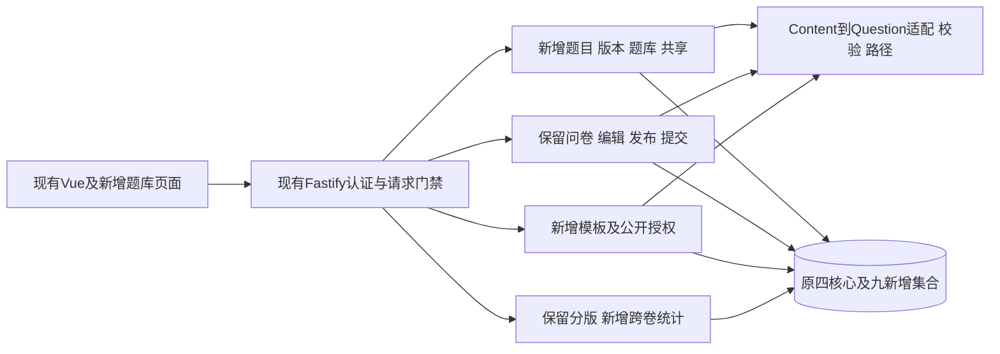

# 系统总体增量设计

更新日期：2026-10-26。第二阶段八项需求及公开模板扩展均已实现并完成对应验证，当前主应用为 `localhost:27019/rs0` 的十三集合 `project2_app_v2`，通过 `:phase2` 命令启动；`project2_app_v1`仅保留四集合兼容基线。题目、题库、共享、固定引用、使用查询、跨问卷统计和模板均已接入API及页面。

2026-10-25已完成界面收尾、真实第一阶段数据的隔离恢复升级及当前本机数据库认证部署；应用使用受限账号，20项权限检查通过。真实迁移结果保存在独立目标库，当前网站继续使用第二阶段验收数据。S04/S05/S06均已确认实施。见[最终交付核对](phase2/delivery-verification.md)、[认证部署](phase2/authorization-deployment.md)和[真实迁移验证](phase2/real-migration-verification.md)。完整34组自动验收对应10月24日，收尾后的定向复测对应10月25日；原提示词、冻结材料及执行证据保留其历史日期。

当前增量沿原Vue/Fastify/shared/MongoDB结构：新增题目列表、题目编辑与正式历史、题库、使用情况4页；编辑器增加来源面板和固定选版，QuestionCard保留旧默认行为。phase2专用入口注册Library/SurveySources/Usage；baseline默认入口保留原API。两条实际浏览器链及宽度320/768/1024/1440检查通过；W05跨卷统计和W06模板广场/预览/公开授权/窄权派生页面已接真实API，见各自验收说明。

## 1 现状与目标

实际第一阶段为Vue3/TypeScript/Vite前端、Fastify5单体API、MongoDB原生驱动与共享校验/跳转模块。四核心集合、不可变问卷发布、提交幂等及分版本统计已实现。复制接口仍501；数据库认证与受限角色已在当前本机部署，真实旧数据已在独立目标验证迁移，未知格式旧库和跨设备部署不在已完成范围内。旧文档“没有package.json/三集合”不是当前事实。

第二阶段在现单体增加题目领域，不更换栈或主系统。教师必做题复用/版本/共享/题库/使用情况/跨卷统计；模板广场是扩展。字段主契约见[数据库](database-design.md)，HTTP见[API](api.md)，业务主规则见[需求决策](phase2/requirements-decisions.md)。

有限题内容、配置、模板继续嵌入；无界历史/授权/成员/绑定独立分页。新增操作回执不替换原发布key或答卷key。共享只授题使用权，不授问卷读权；模板不公开答卷或统计。

## 2 已实现文件与职责

第二阶段沿用原工程结构，下表列出当前源码的主要维护位置。

| 当前文件或目录 | 职责 |
| --- | --- |
| `apps/api/src/database/schema.ts`、`models.ts`、`initialize.ts` | 保留四集合兼容基线 |
| `apps/api/src/database/phase2-schema.ts`、`phase2-models.ts`、`schema-registry.ts`、`phase2-initialize.ts` | 十三集合类型、验证器和索引，独立初始化与只读检查 |
| `apps/api/src/config.ts`、`main-phase2.ts`；`scripts/configure-phase2.mjs`、`start-mongo.ps1`、`stop-mongo.ps1` | 第二阶段专用配置、端口、目录、实例归属检查及启停 |
| `packages/shared/src/question-content.ts`、`validation-common.ts`、`questions.ts`、`answers.ts` | Content/Config适配，保留原Question/Answer及校验、路径逻辑 |
| `apps/api/src/content-codec.ts`、`question-codec.ts`、`dto.ts` | BSON十进制转换、物化及输出白名单 |
| `apps/api/src/app.ts`、`core/library-routes.ts`、`template-routes.ts`、`cross-statistics-routes.ts` | 新旧路由注册、认证、CSRF、请求及查询参数检查 |
| `apps/api/src/core/library.ts`、`survey-sources.ts`、`question-usage.ts` | 题目草稿、版本、恢复、派生、题库、共享、引用换版、发布与使用查询 |
| `apps/api/src/database/phase2-context.ts`、`operation-contract.ts`、`receipt-codec.ts`、`binding-integrity.ts`、`source-read.ts` | 受控事务、完整回执、来源一致性及存量取得权 |
| `apps/api/src/core/publication.ts`、`submission.ts`、`versions.ts`、`reporting.ts`、`cross-statistics.ts` | 原发布提交与分版统计、新增同题同版跨卷统计 |
| `apps/api/src/core/templates.ts`、`distribution-grants.ts`、`distribution-lineage.ts` | 固定模板、公开授权与上游来源检查 |
| `apps/web/src/pages/`、`components/`、`library-client.ts`、`reporting-client.ts` | 原问卷页面及新增题目、题库、使用情况、跨卷统计、模板页面与交互 |
| `apps/api/src/database/credentials.ts`；`scripts/secure-phase2.mjs`、`app-role.mongosh.js`、`mongo-maintenance.mjs` | 私有凭据、受限应用角色及独立维护身份 |
| `scripts/migrate-phase2.ts`、`migrate-phase1-real.ts`、`verify-real-migration.ts`；`tests/phase2/` | 受控迁移、真实旧数据验证及新增/兼容自动测试 |

具体数据、HTTP和事务规则分别由数据库设计、API说明及关键逻辑维护，原始实施步骤保留在各轮记录中。

## 3 页面流程与权限

“我的题目/共享给我/题库”保存草稿与“保存正式题版本”分开；图按parent显示来源，恢复产生新版。问卷选题明确固定版，必答/顺序/跳转仍在问卷配置；收集中先暂停，替换失效明确提示并阻发布。有权访问新版才提示，不自动切换。

使用查询每问卷一行，在versions各项标明草稿/当前/历史并稳定排序；先versionId过滤再算问卷汇总，不返回历史发布号数组。本人可标题/入口，他人仅用户名、独立编号、版本与状态，编号不做链接。模板仅结构预览，公开分发授权与定向共享分开；自己的派生题公开也需逐层来源权，正常自用/编辑不受公开失败影响。未知来源显示待核验，失效模板不能公开预览/选用，管理端按稳定错误修复；不公开内部证明或完整祖先详情。多级授权的grant目标是实际publisher，中间作者不能代授上游，选用生成自己的新草稿且实例/规则目标重映射。跨卷统计单独入口，选题身份及正式版，只展示本人问卷来源/回答份数，数字频数与区间可用。

新增页面均处理加载、无数据、越权、授权失效、409保留本地输入及5xx未知结果。删题库只整理；撤销说明已保存保留、新增禁止。S04已确认并实施；公开模板S05/S06已确认。

## 4 环境和交付门禁

当前主入口接受27019/rs0的 `project2_app_v2` 或明确的合成测试目标；四集合兼容入口另行限制在 `project2_app_v1` 及测试库。配置、实例标记、实际目录与监听进程均检查归属。启动和ready只校验，不自动迁移或修复Schema；新库初始化、旧数据升级及认证部署分别执行。当前本机已启用认证，应用与维护身份分开。见[运行方法](../README.md#配置与启动)、[升级流程](phase2/data-migration-plan.md)和[实际认证部署](phase2/authorization-deployment.md)。

测试前提和原计划见[实施测试计划](phase2/implementation-test-plan.md)，最终结果见[交付核对](phase2/delivery-verification.md)。第二阶段报告已由作者整合为根目录 `PJ1_2.docx`，最终排版、内容确认及课程提交由作者完成。

[项目入口](../README.md) · [第一阶段历史测试](testing/submission-test-cases.md)

## 来源绑定与操作回执模块

database/operation-contract.ts、receipt-codec.ts、binding-integrity.ts和phase2-context.ts处理请求及完整结果、来源一致性和受控事务，已由第二阶段主应用接入。业务服务从现有认证取得账号，核对问卷归属、状态、修订和动态授权；发布服务在同一事务保存快照、发布绑定并更新指针。早期仅作者来源的内部组合保留其适用范围，当前共享、模板及迁移来源由正式业务服务处理。基础实现历史见[W02-B](phase2/bindings-receipts-foundation.md)，后续接入见[W02—W04](phase2/w02-w04-implementation.md)。

## P2-010 W06实际模块

phase2入口新增DistributionGrant/DistributionLineage/Template服务与TemplateSquare/Preview页面；模板发布组件复用不可变问卷发布列表，实例窄派生复用Content编辑和直接派生首版替换。公开资格统一完整来源服务，存量使用由source-read核固定取得事实。访问权/统计权分离；当前本机已部署受限应用角色，模板字段及发布绑定不变性继续由应用层保证。具体事务/测试见[模板说明](phase2/template-square.md)。
